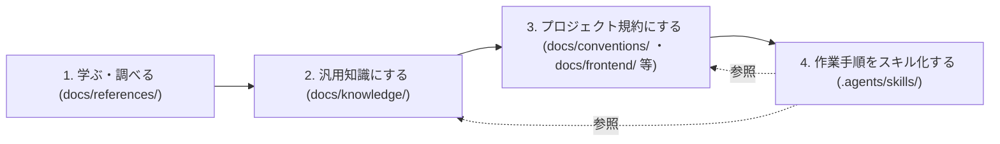

# docs を土台にした Agent Skills の作り方

AI エージェント向けのスキル（`.agents/skills/`）を作るときは、`SKILL.md` の中に設計知識や規約の全文を直接書き込まず、まず `docs/`（OKF: Open Knowledge Format）に知識と規約を整備し、スキル側からはその `docs/` を参照して作業手順（ワークフロー）だけを指示する。
知識の正（Single Source of Truth）を `docs/` に置くことで、人間が学ぶ内容と AI が従うルールの二重管理を防ぎ、ツールやプロジェクトが変わっても腐らない資産として持ち運ぶことができる。

## docs（OKF）と Agent Skills の役割分担

`docs/` と `.agents/skills/` はどちらも YAML Frontmatter 付きの Markdown ファイルで構成されるが、役割と読み手が異なるため、混ぜずに分けて管理する。

| 項目       | `docs/`（OKF）                                                                                                                                                                        | `.agents/skills/`（Agent Skills）                                                                     |
| :--------- | :------------------------------------------------------------------------------------------------------------------------------------------------------------------------------------ | :---------------------------------------------------------------------------------------------------- |
| 役割       | 知識・仕様・判断理由（What / Why）。どういう設計原則か、なぜそう決めたかを書く                                                                                                        | AI の作業手順・自動化ワークフロー（How to act）。特定の依頼が来たときにどの順番で何を実行するかを書く |
| 主な読み手 | 人間と AI エージェントの両方                                                                                                                                                          | AI エージェント専用（ツールが起動時に自動認識する）                                                   |
| 形式       | `type`、`title`、`description`、`verified`、`stale_after` などの Frontmatter と階層ごとの `index.md`（[Open Knowledge Format (OKF) v0.2 仕様 要約](/references/documentation/open-knowledge-format-spec.md)） | `name` と `description` の Frontmatter を持つ `SKILL.md` と補助スクリプト                             |
| 配置場所   | `second-brain/`（またはプロジェクトの `docs/`）配下                                                                                                                                                                          | `.agents/skills/`（または `.claude/skills/`）                                                         |

外部から導入した汎用スキル（`.agents/skills/golang-*` や `vercel-react-best-practices` など）は、それ自体が独立したパッケージとして完結しているため、同じ内容を `second-brain/` や `docs/` 側に転記して二重に文書化する必要はない（[書く場所の選び方](/knowledge/documentation/where-to-document.md)）。

## docs から Agent Skills を育てる 4 ステップ

新しい技術領域や設計ルールを学びながら AI ハーネスを強化するときは、いきなり `SKILL.md` を書くのではなく、次の 4 段階で育てる。



1. 学ぶ・調べる（`docs/references/`）
   1. 新しく学ぶ技術トピックや外部資料（公式ドキュメント・技術書・定番リポジトリ等）を調査し、資料ごとに 1 ファイルで、プロジェクト固有の事情を含まない形で `docs/references/` に要約する。
1. 汎用知識へ昇格させる（`docs/knowledge/`）
   1. `docs/references/` の要約を出典にして、今後の開発でも継続して使いたい設計原則や考え方を、プロジェクト非依存の汎用ナレッジとして `docs/knowledge/` に書く。出典に書かれていない話は書かない。
1. プロジェクトの規約・設計に当てはめる（`docs/conventions/`・`docs/frontend/`・`docs/backend/` 等）
   1. `docs/knowledge/` や `docs/references/` の文書を土台としてリンクし、このプロジェクトでどう適用するかという具体的なルールだけをプロジェクト固有のディレクトリに書く。
1. 定型作業をスキル化する（`.agents/skills/<skill-name>/SKILL.md`）
   1. 「毎回この規約に沿って実装・レビュー・検査を AI に実行させたい」という定型作業が固まった段階で、対象の `docs/` を読みに行く Skill を作成する。

## SKILL.md の書き方（知識を詰め込まず参照させる）

自作の `SKILL.md` を書くときは、設計原則やコーディング規約の本文を `SKILL.md` にコピーしてはならない。
`SKILL.md` には「いつこのスキルを発動するか（`description`）」と「どの順番でどの `docs/` を読み、どのコマンドで検証するか」という手順だけを書く。

```markdown
---
name: frontend-feature-guideline
description: Next.js フロントエンドの新規機能コンポーネントや API 通信層を作成・レビューするときに使用する。
---

# フロントエンド機能実装・レビュー手順

フロントエンドの機能追加やレビューを行う際は、以下の手順に従うこと。

## 1. 事前知識・規約の確認

作業を始める前に、変更内容に関係する以下のドキュメントを `view_file` 等で読み込むこと。

- ディレクトリ構成と責務分割: `docs/knowledge/frontend/architecture/nextjs-app-and-features.md`
- コンポーネントと API 通信の設計: `docs/frontend/index.md` から該当する規約を参照する

## 2. 実装・レビューの実施

読み込んだ規約に沿って実装またはレビューを行う。

## 3. 検証コマンドの実行

変更完了後、以下のコマンドで静的解析とテストが通ることを確認する。

- `pnpm exec oxlint`
- `pnpm exec oxfmt --check`
```

このように書いておけば、後から設計方針やルールを変更したくなった場合でも、`docs/` 側の文書を 1 か所更新するだけで AI の振る舞いにも即座に反映される。

## ハーネス用スクリプトの置き場所と使い分け

AI エージェントやワークフローから呼び出すスクリプトには、用途に応じて 2 つの置き場所がある。

| 置き場所                                           | 用途・向いているもの                                                                                                                           | 具体例                                                                                                                                                         |
| :------------------------------------------------- | :--------------------------------------------------------------------------------------------------------------------------------------------- | :------------------------------------------------------------------------------------------------------------------------------------------------------------- |
| `scripts/harness/`（リポジトリ直下）               | 人間がターミナルから直接実行したいもの、CI や `Taskfile.yaml` からも共通で呼び出すもの、複数の規約やスキルから横断的に使う検査・集計スクリプト | [docs_check.py](../scripts/harness/docs_check.py)、[clarify_report.py](../scripts/harness/clarify_report.py)、[probe.sh](../scripts/harness/probe.sh) |
| `.agents/skills/<skill-name>/scripts/`（スキル内） | その特定の Skill が動いたときにしか使わない専用補助スクリプトで、スキル 1 フォルダだけを単体で配布・完結させたいもの                           | スキル専用のテンプレート生成スクリプトなど                                                                                                                     |

`docs_check.py` のように規約（`docs/conventions/`）と対になってリポジトリ全体を検査するスクリプトは、`scripts/harness/` に置き、特定の業務コードに依存しない汎用スクリプトとして実装する。

## 別プロジェクトへ持ち出すときの単位

このリポジトリで育てた知識・スキル・ハーネスを別のプロジェクトへ持ち出して再利用するときは、次の 3 つをセットでコピーする。

1. プロジェクト非依存の知識（`docs/` の一部）
   1. `docs/knowledge/`（汎用の設計知識と考え方）
   1. `docs/references/`（外部資料の要約）
   1. 持ち出す前に `python3 scripts/harness/docs_check.py` を実行し、プロジェクト固有の文書やコードへの逆向きリンクが混ざっていないことを確かめる。
1. エージェントのスキル（`.agents/skills/`）
   1. 外部の汎用スキル、および `docs/knowledge/` や `docs/references/` を参照する汎用自作スキルを持ち出す。
1. ハーネス用スクリプト（`scripts/harness/`）
   1. `docs_check.py` などの汎用検査・集計スクリプトを `scripts/harness/` ごとコピーする。

## 決定理由（Rationale）

- 知識を `SKILL.md` ではなく `docs/`（OKF）に置くのは、`SKILL.md` に知識を閉じ込めると AI しか読まないブラックボックスになり、人間が学習・参照するドキュメントと AI の判断基準が乖離するためである。
- `docs/` を標準的な Markdown（OKF）で整備し、Skill を薄い参照レイヤにとどめることで、将来 AI エージェントのツールやスキルの仕様が変わっても、核となる知識資産を書き換えずに使い続けられる。

## See also

- [Open Knowledge Format (OKF) v0.2 仕様 要約](/references/documentation/open-knowledge-format-spec.md)
- [書く場所の選び方](/knowledge/documentation/where-to-document.md)
- [文書の保守](/knowledge/documentation/documentation-maintenance.md)
- [scripts/harness/docs_check.py](../scripts/harness/docs_check.py)
