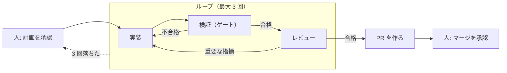

# 無人の実装ラインの組み立て方

無人の実装ライン（AI エージェントが人の見張りなしで実装を進める仕組み）では、人は影響が最も大きく、最も元に戻しにくい地点にだけ立つ。
その間は、チェックが合否を決める。
途中の出力を人が確かめると、ラインは人が読む速さでしか進まない。

## ラインの形

- ループ（作る・確かめる・直すを合格まで繰り返す仕組み）は、1 つの作業単位の中で回す。
- ループの中心は、人がいない間に作業を不合格にできるチェックである。
  チェックの作り方は [失敗できるゲートの作り方](/knowledge/ai-agents/fail-capable-gate.md) に、レビューの作り方は [評価役を実装役から分ける](/knowledge/ai-agents/independent-reviewer.md) にある。
- 作る順番は、ゲート、レーン、学習の戻り道（[失敗を恒久的な検査に変える](/knowledge/ai-agents/failure-ratchet.md)）の順にする。
- 判定、並べ替え、集計のように正解が 1 つに決まる処理は、モデルではなくコードで書く。
  モデルに通すと、もともとなかった費用・遅延・ばらつきが加わる。

## 合格条件を先に書く

- 計画には、合格条件を先に、プログラムで判定できる形で書く。
  例: テストが終了コード 0 で終わる、差分が計画に挙げたファイルだけに触れている。
- 計画の作業の切り方は、どの作業単位よりも多くを決める。
  誤った軸で切ると、下流の作業がすべて無駄になる。

## 単位で差し戻す

不合格のとき、ラインは作業全体ではなく、落ちた単位だけを差し戻す。
全体を戻すと、正しかった部分まで書き直され、それぞれが無関係な理由で落ちうるので収束しない。

- 差し戻しには、対象、判定、理由、証拠（期待値と実際の値、ファイルと行）を付ける。
- さらに範囲の指定（そのファイルだけを直し、ほかには触れない）を付ける。
  範囲がないと、エージェントが近くの問題まで直し、1 か所の修正が誰もレビューしていない広い差分になる。

## 試行の上限

- 試行は 3 回までにする。
  3 回直しても落ちる単位は、それを生んだ計画に問題があり、ループからは計画が見えない。
  上限で止まったら、実装ではなく計画を見直す。
- レビューとの往復にも上限を設け、3 回を過ぎたら一歩引いてやり方を考え直す。

## レーン: 戻す費用で人の関わり方を決める

PR にどれだけ人の確認を求めるかは、モデルの自信ではなく、変更が誤っていたときに元に戻す費用で決める。
自信は、モデルが影響を与えられる唯一の入力なので、判断の材料として最も弱い。

| レーン             | 変更の例                                     | 扱い                                             |
| :----------------- | :------------------------------------------- | :----------------------------------------------- |
| 戻せて範囲が狭い   | 文言、テスト、テストのある独立した関数       | revert で済むので、最初に開ける                  |
| 戻せるが範囲が広い | 共有の部品、スキーマの追加、多数の呼び出し元 | 決定的なチェックと、きれいな実行の経過で判定する |
| 戻すのが難しい     | マイグレーション、削除、本番データの書き込み | スコアに関係なく開かない                         |

- 3 つ目は「とても高い閾値」ではなく、開かないレーンにする。
  閾値は調整されるが、閉じたレーンは調整されないためである。
- レーンは、作者ではなく変更の中身から決める。
- 開いたレーンの中では、証拠を次の順に読む。
  決定的な結果、今回の実行の経過、その作業が過去に差し戻された頻度、最後にモデル自身の評価。
- エージェントの承認は、人の承認として数えない。
  承認は、確かめた特定の 1 コミットにだけ有効とする。

## See also

- [エージェントの各ステップを見張らずに済ませるループとグラフ](/references/ai/hanakoxbt-loops-and-graphs.md)
- [Claude Code チームのコードレビューの進め方](/references/ai/claude-blog-claude-code-team-code-review.md)
- [失敗できるゲートの作り方](/knowledge/ai-agents/fail-capable-gate.md)
- [評価役を実装役から分ける](/knowledge/ai-agents/independent-reviewer.md)
- [失敗を恒久的な検査に変える](/knowledge/ai-agents/failure-ratchet.md)
