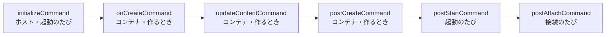

# Dev Container のライフサイクルコマンドとマウント

`devcontainer.json` では、コンテナを作るときや起動するときに動かすコマンド（ライフサイクルコマンド）と、ホストのどのディレクトリをコンテナに見せるか（マウント）を決める。
コマンドごとに「ホストで動くかコンテナで動くか」「1 回だけか毎回か」が違うので、置き場所を間違えると、作り直したときに設定が消えたり、毎回重い処理が走ったりする。

## ライフサイクルコマンド

コマンドは次の順で動く。

| コマンド               | 動く場所 | いつ動くか                                                                 |
| :--------------------- | :------- | :------------------------------------------------------------------------- |
| `initializeCommand`    | ホスト   | コンテナを作るときと、その後の起動のたび。1 回の起動で複数回動くこともある |
| `onCreateCommand`      | コンテナ | コンテナを作って初めて起動した直後                                         |
| `updateContentCommand` | コンテナ | 作る途中で、ソースに新しい内容があるとき。少なくとも 1 回は動く            |
| `postCreateCommand`    | コンテナ | 作った後、初めて利用者に割り当てられたとき                                 |
| `postStartCommand`     | コンテナ | 起動に成功するたび                                                         |
| `postAttachCommand`    | コンテナ | ツールが接続に成功するたび                                                 |

- どのコマンドも、ソースをマウントした後に、`workspaceFolder` で動く。
- 1 つのコマンドが失敗すると、後のコマンドは動かない。
  たとえば `postCreateCommand` が失敗すると、`postStartCommand` 以降は飛ばされる。
- `onCreateCommand` から `postCreateCommand` までは、コンテナを作ったときにしか動かない。
  後から足した処理を今のコンテナに反映するには、コンテナを作り直す（rebuild）。
- `initializeCommand` はホストで動くので、マウント元のディレクトリやファイルをホストに用意する処理に向く。

## マウント

| 設定              | すること                                                                                      |
| :---------------- | :-------------------------------------------------------------------------------------------- |
| `workspaceMount`  | ソースを置くマウントを、既定のものから差し替える。書き方は Docker の `--mount` と同じ         |
| `workspaceFolder` | ツールがコンテナに接続したときに開くパス。`workspaceMount` を変えたら、こちらも合わせて決める |
| `mounts`          | ソースのほかに足すマウント。書き方は Docker の `--mount` と同じ                               |

マウントの値には、次の変数が使える。

| 変数                              | 値                                                                                               |
| :-------------------------------- | :----------------------------------------------------------------------------------------------- |
| `${localWorkspaceFolder}`         | ホストで開いたフォルダ（`.devcontainer/devcontainer.json` があるフォルダ）のパス                 |
| `${localWorkspaceFolderBasename}` | そのフォルダの名前                                                                               |
| `${localEnv:変数名}`              | ホストの環境変数。設定されていなければ空になる。`${localEnv:変数名:既定値}` で既定値を付けられる |

- マウントしたディレクトリはホストにあるので、コンテナを作り直しても消えない。
  マウントしていない場所に置いたものは、作り直すと消える。
- `containerEnv` に書いた環境変数は、変えたら作り直さないと反映されない。
  `remoteEnv` は作り直さなくても変えられる。

## See also

- [Dev Container metadata reference（Development Containers 公式）](https://containers.dev/implementors/json_reference/)
