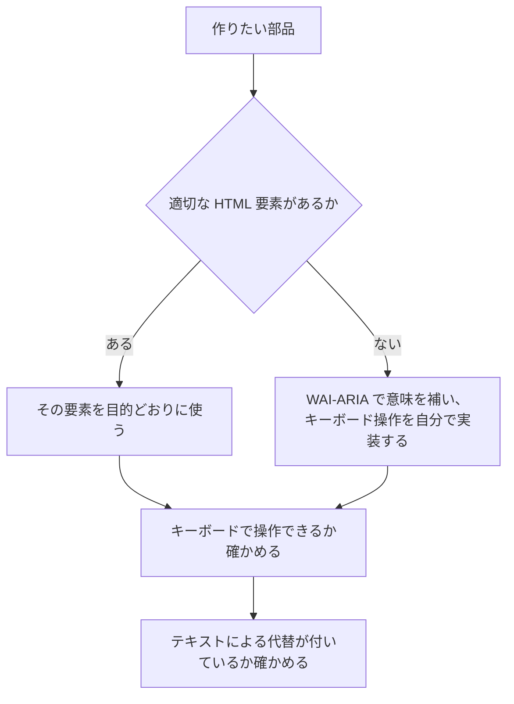

# Web アクセシビリティの基本

アクセシビリティ（A11y）とは、能力に制限がある人も含め、できるだけ多くの人が Web サイトを使えるようにすることである。
要点は、まず正しい HTML 要素を目的どおりに使い、足りない意味だけを WAI-ARIA で補い、キーボードで操作できるようにすることである。
内容は MDN、WAI-ARIA Authoring Practices Guide（APG）、Testing Library のドキュメントの要約をもとにしている。

## 判断の順番

UI 部品を作るときは、次の順に検討する。



- 正しい HTML 要素を、正しい目的でいつも使うだけで、多くの Web コンテンツはアクセシブルになる。
  （MDN は、これを「HTML: A good basis for accessibility」の主題として挙げている。）
- 意味を持たない HTML や、動的に更新される複雑な UI 部品は、アクセシブルにするのが難しいことがある。
  そのときに WAI-ARIA で、ブラウザーや支援技術が認識できる意味を足す。
- 動画、音声、画像には、テキストによる代替を付ける。
- CSS と JavaScript は、適切に使えばアクセシブルな体験を可能にするが、誤用すると大きく損なう。

## セマンティック HTML を先に使う

HTML の要素は、意味に加えて、操作の仕組みをブラウザーから受け取れる。
ARIA のロールは意味を伝えるだけで、操作は与えない。

- `<div role="button">` は、作者がボタンに期待されるキーボード操作を JavaScript で実装した、という約束である。
- HTML の input 要素と違い、ARIA のロールはブラウザーにキーボード操作やスタイルを与えない。
- したがって、同じ役割の HTML 要素があるなら、ARIA を足すより要素を選ぶほうが確実である。

## WAI-ARIA は必要なときだけ使う

APG は「No ARIA is better than Bad ARIA」と述べ、ARIA を使う前に 2 つの原則を理解するよう求めている。

1. ロールは約束である。
   - ロールを付けたら、そのロールに期待される動作を実装する責任が生じる。
   - 約束を果たさないロールは、利用者を誤解させる。
1. ARIA は覆い隠すことも、補強することもできる。
   - 覆い隠す例は、`<a role="menuitem">` である。
     支援技術の利用者には、リンクではなくメニュー項目として知覚される。
   - 補強する例は、`<button aria-pressed="false">Mute</button>` である。
     元の内容に、押された状態という意味を足している。

誤った ARIA は、スクリーンリーダーの利用者の体験に重大な悪影響を与えうる。
APG の例を本番で使う前に、対象とするブラウザーと支援技術の組み合わせで、実際にテストする。

## ARIA が必要な部品は APG のパターンに従う

アコーディオン、ダイアログ、タブ、コンボボックスのような複雑な部品は、HTML 要素だけでは足りないことがある。
APG の Patterns は 30 のパターンを挙げ、ARIA のロール、状態、プロパティとキーボード操作の実装を、動作する例つきで示している。

- 自前で作る前に、同じ名前のパターンがないか探す。
- 要素に付ける名前（アクセシブルな名前）と、必要なら説明を与えることは、アクセシブルな Web 体験を作るうえで最も重要な責務の 1 つとされる。
- ページの区分は、HTML の区分要素と ARIA のランドマークロールで、支援技術の利用者に伝えられる。

## キーボードで操作できるようにする

キーボードのアクセシビリティは、開発者が知っておくべき最低限の要件の一部である。

- `<div>` や `<span>` で作った装飾付きのウィジェットは、そのままではキーボードで使えない。
- JavaScript のウィジェットをキーボードで使えるようにする技法は、MDN の「Keyboard-navigable JavaScript widgets」にまとまっている。

## 目標は WCAG に置く

どこまでやれば十分かの基準として、MDN は WCAG（Web Content Accessibility Guidelines）への準拠を挙げている。

- MDN には、WCAG の推奨事項に準拠するための手順を説明する記事の集まりがある。
- 色と輝度、発作を起こしうる視覚パターン、認知や学習の違いへの配慮、モバイル向けのチェックリストなど、個別の話題のガイドもある。

## テストでアクセシビリティを確かめる

Testing Library のクエリの優先順位は、アクセシビリティの考え方と重なっている。
テストはユーザーがコードを使う方法にできるだけ似せるべきだとされ、全員が使える手段が最優先に置かれる。

1. 全員が使えるクエリ: `getByRole`、`getByLabelText`、`getByPlaceholderText`、`getByText`、`getByDisplayValue`。
1. セマンティッククエリ: `getByAltText`、`getByTitle`。
1. テスト ID: `getByTestId`。
   role やテキストで探せないときだけ使う。

```tsx
screen.getByRole('button', { name: /submit/i });
screen.getByLabelText('Username');
```

- `getByRole` は、アクセシビリティツリーに公開されている要素を探せ、`name` オプションでアクセシブルネームによる絞り込みもできる。
  ほとんどあらゆる場面で第一の選択肢とされる。
- `getByRole` で取れないなら、UI がアクセシブルでない可能性がある。
  テストが書きにくいことが、HTML の選び方やラベルの不足に気づく手がかりになる。
- `getByLabelText` はフォームの入力欄に向く。
  プレースホルダーはラベルの代わりにならない。
- `getByTitle` は、title 属性がスクリーンリーダーで一貫して読み上げられないため、優先順位が低い。
- クラスや id で探す手動のクエリは、ユーザーには見えないので推奨されない。

自動テストは、アクセシビリティの確認の一部にすぎない。
APG は、支援技術との相互運用性を実際にテストすることが不可欠だとしている。
テスト全体の考え方は [フロントエンドのテストの考え方](/knowledge/frontend/testing/frontend-testing-strategy.md) を参照する。

## See also

- [MDN: Accessibility 要約](/references/frontend/accessibility/mdn-accessibility.md)
- [WAI-ARIA Authoring Practices Guide: Patterns 一覧 要約](/references/frontend/accessibility/wai-aria-apg-patterns.md)
- [Testing Library: About Queries 要約](/references/frontend/testing/testing-library-queries.md)
- [フロントエンドのテストの考え方](/knowledge/frontend/testing/frontend-testing-strategy.md)
- [定番の UI 部品の名前と探し方](/knowledge/frontend/ui-design/ui-component-names.md)
