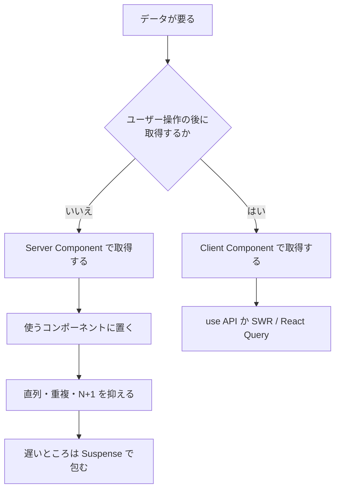

# React と Next.js のデータ取得の置き場所

結論は、データ取得は Client Component ではなく Server Component に置き、そのデータを使うコンポーネントの近くで取得することである。
そのうえで、重複・直列化・N+1 を抑え、遅い取得は Suspense で後から流し込み、リクエストの関数は 1 つの API クライアントの上に宣言としてまとめる。
内容は Next.js 公式ドキュメント、akfm 氏の『Next.jsの考え方』、Bulletproof React、React 公式ドキュメントをもとにしている。

## どこで取得するか

### 初期表示のデータは Server Component で取得する

- 『Next.jsの考え方』は、データフェッチを Client Component ではなく Server Component で行うことをベストプラクティスとしている。
  Next.js 公式も、Server Component を async 関数にして `fetch` や ORM で直接取得する形を示している。
- 利点は次のとおりである。
  - サーバー間の通信は多くの場合高速で安定している。
  - `await fetch()` だけで書け、取得用のライブラリが要らない。
  - API をパブリックなネットワークに公開することが必須ではなくなり、セキュリティ上の負担が減る。
  - 取得のコードがクライアントのバンドルに含まれない。
- Server Component から ORM やデータベースを直接使うときも、リクエストの認証と認可は確認する必要がある（Next.js 公式）。
- クライアント側の取得は、通信が遅くなりやすく、通信回数を減らすと責務の大きい API（God API）になりやすい。
  細かい API（Chatty API）にするとウォーターフォールが起きやすい（『Next.jsの考え方』）。

### 取得は使うコンポーネントに置く（コロケーション）

- コロケーションとは、コードをできるだけ関連性のある場所に置くことである。
- Pages Router ではページの外側で取得して props を渡し続けるバケツリレーが必要だった。
  App Router では、末端のコンポーネントで取得すれば、バケツリレーがなくなる（『Next.jsの考え方』）。
- 小さな画面ならページコンポーネントでの取得でもよい。
  ページが大きくなったら、できるだけ末端で取得する（『Next.jsの考え方』）。
- 同じ取得が何度も実行される心配は、次の節の Request Memoization が解消する。

### Effect で取得するのは最後の手段にする

- Effect は React の外の仕組みと同期するための抜け道であり、描画のためのデータ変換やユーザー操作の処理には要らない（React 公式）。
- データ取得の Effect には、競合状態（古い応答が最後に届き、誤った結果が表示される）の問題がある。
  対策はクリーンアップ関数で古い応答を無視することである（React 公式）。
- 競合状態のほかにも、応答のキャッシュ、サーバーでの取得、ネットワークの滝の回避といった課題がある。
  React 公式は、Effect で取得するより、フレームワーク組み込みの取得の仕組みのほうが効率がよいとしている。
- フレームワークを使わないなら、取得を `useData` のようなカスタムフックに取り出す。
  後でフレームワークの仕組みに移行しやすくなる（React 公式）。
- 子が取得したデータを Effect で親へ渡すと、データの流れが追いにくくなる。
  親で取得して props で子へ渡す（React 公式）。

## 重複と直列取得を避ける

### 重複は Request Memoization と React.cache で防ぐ

- `fetch` は、React のコンポーネントの木の中で同じ呼び出しを自動でメモ化する（Next.js 公式）。
  メモ化とは、同じ呼び出しの結果を使い回すことである。
- 重複と判定されるには、同じ URL と同じオプションが要る。
  オプションが 1 つでも違えば別のリクエストになる（『Next.jsの考え方』）。
- オプションの指定ミスを避けるため、複数のコンポーネントで使いうる取得は、取得用の関数として分けて 1 か所に置く。
  誤ってクライアントで使わないよう、`server-only` で保護することも勧められている（『Next.jsの考え方』）。
- `fetch` を使わない ORM やデータベースのクエリは、関数を `React.cache` で包む。
  同じ引数の呼び出しは、1 回のリクエストの中で同じ結果を共有する。
  有効範囲は現在のリクエストだけで、リクエストの間では共有されない（Next.js 公式）。

### 依存がない取得は並列にする

- データ間に依存があれば直列にせざるを得ない。
  依存がなければ並列にすると速い（『Next.jsの考え方』）。
- 1 つのコンポーネントの中で `await` を続けて書くと直列になる。
  先に関数を呼んで Promise を受け取り、`Promise.all` で待つと並列になる。
  `Promise.all` は 1 つでも失敗すると全体が失敗するので、避けたいときは `Promise.allSettled` を使う（Next.js 公式）。
- 『Next.jsの考え方』は、並列化の手段を次の順で考えるとしている。
  1. 取得の単位でコンポーネントを分ける。
     兄弟のコンポーネントは並行に描画されるが、ネストすると直列になる。
  1. 取得の単位が分けられないなら、`Promise.all()` などで並行に取得する。
  1. 親子関係にせざるを得ないなら、preload パターンを使う。
- preload とは、`await` せずに取得関数を呼ぶだけの関数を、ブロックする処理の前に呼んでおくことである。
  あとで同じ呼び出しがメモ化された結果を再利用する。
  重複を排除する関数（`fetch`、`React.cache`、`'use cache'`）でなければならない（Next.js 公式）。
- preload したのに使われなくなると、不要な取得が残る（『Next.jsの考え方』）。
  preload の関数は、データを使うコンポーネントの隣に置くと、依存を見つけやすい（Next.js 公式）。

### 細かく分けると N+1 が起きる

- 取得の単位を細かくすると N+1 が起きやすい。
  例は、投稿一覧を 1 回取得し、子が投稿ごとに著者を取得して 1 + N 回になる場合である（『Next.jsの考え方』）。
- 対策は、API 側で ID を複数指定して一括取得できるようにし、Next.js 側で DataLoader を使うことである。
  DataLoader は、短い間の `load(id)` の呼び出しをまとめてバッチ処理するライブラリである。
- DataLoader はキャッシュを持つので、リクエストをまたいで共有すると予期しないデータ共有になる。
  リクエストごとに作るため、生成関数を React の `cache()` で包む。
- バックエンド API が一括取得に向かないなら、最初の 1 回で関連情報を全部取得する Eager Loading もある。
  偏りすぎると God API になる（『Next.jsの考え方』）。
- 『Next.jsの考え方』は、Server Component 向けの API は細かい単位に分かれているほうが望ましいとする。
  ただし、API には複数の利用者がいることがあり、Next.js 側の都合だけでは決められない。

## 読み込み中の見せ方

- 遅い取得があると、すべて取得し終わるまでルート全体の描画が止まる。
  ページを小さく分けて少しずつ送ることを、ストリーミングと呼ぶ（Next.js 公式）。
- 方法は 2 つある（Next.js 公式）。
  - `loading.js` をページと同じフォルダに置く。ページ全体を `<Suspense>` で自動的に包む。
  - 遅い部分だけを `<Suspense fallback={...}>` で包む。境界の外はすぐ表示される。
- `loading.js` と `<Suspense>` で、次の違いがある。
  - `loading.js` は、ルートのセグメント全体のストリーミングに向く。
  - layout が `cookies()` やキャッシュされない取得にアクセスすると、そのセグメントの `loading.js` に切り替わらず、画面移動が止まる。
    Next.js 公式は、そのアクセスの近くに専用の `<Suspense>` を置くことを勧めている。
- ローディング表示は、スケルトンやスピナーのほか、カバー写真やタイトルなど次の画面の小さな一部でもよい（Next.js 公式）。
- 直列になる取得でも、ページ全体を `loading.js` で包めば、ローディング表示はすぐに出せる（Next.js 公式）。

## Client Component で取得する場合

- Server Component が向かないのは、ユーザー操作に基づく取得や、部分的な再描画である。
  `router.refresh()` はページ全体を再描画するので、部分的な再描画には不適切である（『Next.jsの考え方』）。
- Client Component での取得は、次の 2 つが公式に挙げられている（Next.js 公式）。
  1. React の `use` API: Server Component で取得を始め、`await` せずに Promise を props で渡し、Client Component で `use(posts)` と読む。`<Suspense>` で包むとフォールバックが出る。
  1. SWR や React Query: `useSWR` は `data`、`error`、`isLoading` を返す。読み込み中とエラーの表示は、これらで分岐する。
- 1 つの Promise を多くの Client Component で共有するには、props ではなく Context で渡す（Next.js 公式）。
- 『Next.jsの考え方』は、フォームの送信ごとに結果を更新する検索には、Server Functions と `useActionState()` を使うとしている。
  ただし、リロードでの復元や URL の共有が難しい。
  検索が主のページでは、状態を URL に保存することを検討する。
- Bulletproof React は、取得とキャッシュを管理するフックを、react-query や swr などの上に作るとしている。

## リクエストの関数を整理する

- Bulletproof React は、事前に設定した API クライアントのインスタンスを 1 つ作り、アプリ全体で使い回すことを勧めている。
  標準の fetch API や axios などで作る。
- API リクエストはその場で書かず、宣言として定義して export する。
  1 つの宣言は、次の 3 つで構成する。
  1. リクエストとレスポンスの型と、検証用のスキーマ。
  1. API クライアントでエンドポイントを呼ぶ fetcher 関数。
  1. fetcher 関数を使うフック。
- 利点は、エンドポイントを追いやすくなることと、レスポンスの型が下流で推論されて型安全性が上がることである。
- Server Component の取得関数の置き場所は、『Next.jsの考え方』が規模別に示している。
  取得関数が少なければ `fetcher.ts`、ファイルが多ければ `_lib/fetcher.ts`、取得関数が多ければ `_lib/fetcher/` の下に分ける。
  命名やディレクトリはチームで決めておく。

## 資料による強調の違い

- Next.js 公式は、取得の手段（`fetch`、`React.cache`、`use`、ライブラリ）を並べて示す。
- 『Next.jsの考え方』は、設計の判断（コロケーション、粒度、トレードオフ）に重きを置く。
- Bulletproof React は、型・fetcher 関数・フックをまとめた宣言の形を示す。
  フックの層は、react-query や swr の上に作る前提で書かれている。

## See also

- [Next.js の app/ と features/ の分担](/knowledge/frontend/architecture/nextjs-app-and-features.md)
- [React カスタムフックの責務分離とライフサイクル設計指針](/knowledge/frontend/react/react-hook-separation-and-lifecycle.md)
- [Next.js: Fetching Data 要約](/references/frontend/architecture/nextjs-fetching-data.md)
- [Next.jsの考え方（データフェッチ）要約](/references/frontend/architecture/akfm-nextjs-basic-principle.md)
- [Bulletproof React: API Layer 要約](/references/frontend/architecture/bulletproof-react-api-layer.md)
- [React: You Might Not Need an Effect 要約](/references/frontend/react/react-you-might-not-need-an-effect.md)
