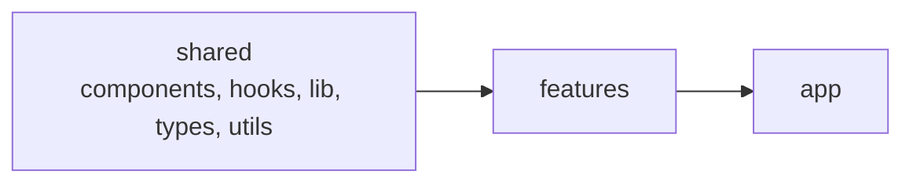

# React アプリのディレクトリ構成

React には従うべき既定の構成がなく、放っておくとコードベースが雑で複雑になりやすい。
機能ごとにコードをまとめ、import の向きに規則を設けるのが、2 つの方式に共通する考え方である。
ここでは Bulletproof React と Feature-Sliced Design（FSD）を、選ぶときに見る点から比べる。

## Bulletproof React の構成

Bulletproof React は、本番向けの React アプリのための意見のあるガイドである。
テンプレートでもフレームワークでもなく、示された構成をすべて守る必要はないと断っている。

### src 直下のフォルダ

コードの大半は `src` に置く。
`src` 直下は、次のフォルダで構成される。

- `app`: アプリケーション層（ルート、全体のプロバイダー、ルーターの設定）。
- `features`: 機能ごとのモジュール。
- `components`、`hooks`、`lib`、`types`、`utils`: アプリケーション全体で共有するもの。
- `stores`、`config`、`assets`、`testing`: グローバルな状態、設定、静的ファイル、テスト用の道具。

### features フォルダ

コードの大半は `features` の中に、機能ごとのフォルダとして整理する。
機能のフォルダには、その機能専用のコードだけを置く。
共有コンポーネントとの混在を防ぎ、フラットなフォルダに多数のファイルを置くより管理しやすくなる。

1 つの機能は、たとえば次のフォルダを持てる。
必要なフォルダだけを置けばよく、すべてを揃える必要はない。

```text
src/features/awesome-feature/
├── api/         # API リクエストの宣言と API のフック
├── components/
├── hooks/
└── types/
```

### 機能間の import を禁止する

機能をまたいで import するのは、良くないことがある。
複数の機能を組み合わせたいときは、アプリケーション層で組み合わせる。
各機能が独立し、コードベースが込み入りにくくなる。

### 一方向のコード構成

コードを shared -> features -> app の一方向に流す。



- 共有部分は、コードベースのどこからでも使える。
- features は、共有部分からだけ import できる。
- app は、features と共有部分から import できる。

機能間の import の禁止も、一方向の構成も、ESLint の `import/no-restricted-paths` で強制できる。

### バレルファイル

以前は、機能のファイルをバレルファイル（まとめて export するファイル）で export することが勧められていた。
しかし、Vite がツリーシェイキングをしにくくなり、性能の問題につながりうる。
そのため、Bulletproof React はファイルを直接 import することを勧めている。

## Feature-Sliced Design の構成

FSD は、フロントエンドのアプリケーションを組み立てるための設計の方法論である。
コードを レイヤー › スライス › セグメント の 3 段で分ける。

### レイヤー

レイヤーは 1 段目で、責務の大きさと他モジュールへの依存の多さで分ける。
名前はすべての FSD プロジェクトで標準化されており、新しいレイヤーの追加は推奨されない。
すべてを使う必要はない。

責務と依存が大きい順に、上から次の 7 つがある。

1. `app`: ルーティング、エントリーポイント、グローバルスタイル、プロバイダー。
1. `processes`（非推奨）: 複数ページにまたがる複雑なシナリオ。
1. `pages`: ページ全体、またはネストしたルーティングでのページの大きな一部。
1. `widgets`: それだけで完結する、機能や UI の大きなまとまり。
1. `features`: 製品の機能全体の、再利用される実装。ユーザーに業務上の価値をもたらす操作。
1. `entities`: プロジェクトが扱う業務上の実体（`user`、`product` など）。
1. `shared`: プロジェクトや業務の個別事情から切り離された、再利用できる機能。

FSD のガイドは、データ取得などの処理が入って `features` と責務が重なりやすいため、`widgets` の使用を推奨していない。

### レイヤー間の import の規則

スライスのファイルは、自分より厳密に下のレイヤーにあるスライスだけを import できる。
たとえば `features/aaa` のファイルは、`features/bbb` を import できず、同じ `features/aaa` の中、`entities`、`shared` は import できる。
`app` と `shared` は例外で、レイヤーであると同時にスライスでもあり、中のセグメント同士は自由に import し合える。

### スライス

スライスは 2 段目で、コードを製品や業務にとっての意味でまとめる。
名前は標準化されておらず、業務ドメインで決まる（SNS なら `post`、`comments`、`news-feed`）。
`app` と `shared` にはスライスがない。
理想のスライスは、同じレイヤーの他のスライスから独立し（結合ゼロ）、主な目的に関わるコードの大半を含む（高い凝集）。

### セグメント

セグメントは 3 段目で、コードを技術的な性質でまとめる。
標準の名前は次の 5 つである。

- `ui`: UI の表示に関するものすべて。
- `api`: バックエンドとのやり取り。
- `model`: スキーマ、ストア、業務ロジックなどのデータモデル。
- `lib`: そのスライスの他のモジュールが必要とするライブラリのコード。
- `config`: 設定ファイルとフィーチャーフラグ。

名前は中身の本質ではなく目的を表す。
`components`、`hooks`、`types` は、コードを探すときに役立たないので悪い名前だとしている。

### 公開 API と @x

すべてのスライス（スライスのないレイヤーではセグメント）は、公開 API を定義しなければならない。
外のモジュールが参照できるのは公開 API だけで、内部のファイル構成は参照できない。
実際には、再エクスポートを並べた index ファイルで実装することが多い。
内部の構造を変えても、アプリの他の部分に影響しないようにするためである。

業務の実体は互いを参照し合うことが多く、同じレイヤーの別のスライスを import したい場合がある。
そのための特別な公開 API が `@x` 表記である。
`entities/A/@x/B.ts` は、`entities/B/` のコード専用の公開 API で、B は `entities/A/@x/B` から import する。
相互 import は最小限にし、この表記は `entities` でだけ使う。

index ファイルには、循環 import や `shared` でのバンドルの肥大などの問題もある。
公開 API の迂回の検出には、FSD の規則を持つリンター Steiger を勧めている。

## 2 つの方式の比較

| 観点                    | Bulletproof React                                        | Feature-Sliced Design                                           |
| :---------------------- | :------------------------------------------------------- | :-------------------------------------------------------------- |
| 分け方                  | `src` 直下を、`features` と共有フォルダと `app` に分ける | レイヤー › スライス › セグメント の 3 段                        |
| 機能内の分け方          | 自由（`api`、`components`、`hooks` など）                | 標準化されたセグメント（`ui`、`api`、`model`、`lib`、`config`） |
| 依存の向き              | shared -> features -> app                                | 上のレイヤーから下のレイヤーへ                                  |
| 同じ階層どうしの import | 機能間の import を禁止                                   | 同じレイヤーのスライス間の import は原則禁止（`@x` が例外）     |
| 公開 API                | 定めない。ファイルを直接 import する                     | スライスごとに必須。index ファイルで実装することが多い          |

- バレルファイルの扱いは、2 つの資料で異なる。
  Bulletproof React は、ツリーシェイキングの問題から直接の import を勧める。
  FSD は、公開 API の実装として index ファイルを挙げつつ、問題点とその対策も示している。
- どちらも、機能を独立させ、依存を一方向にするという点は同じである。

## See also

- [Bulletproof React: Project Structure 要約](/references/frontend/architecture/bulletproof-react-project-structure.md)
- [Bulletproof React: 概要 要約](/references/frontend/architecture/bulletproof-react-overview.md)
- [Feature-Sliced Design: 概要と構成の要約](/references/frontend/architecture/feature-sliced-design-overview.md)
- [Next.js の app/ と features/ の分担](/knowledge/frontend/architecture/nextjs-app-and-features.md)
- [Package by Feature 設計指針](/knowledge/coding/package-by-feature.md)
