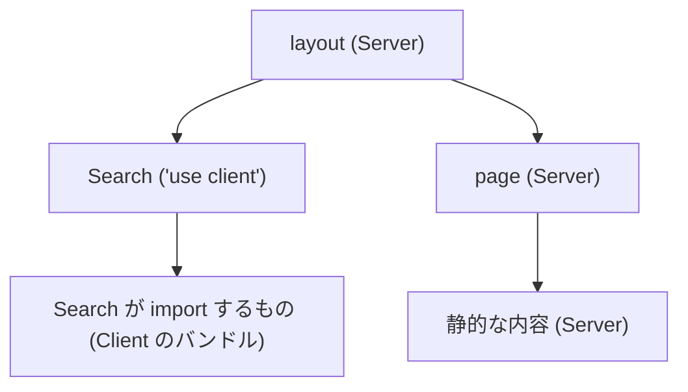

# Server Components と Client Components の分け方

App Router では、layout と page は既定で Server Component（サーバーで描画するコンポーネント）である。
対話やブラウザの API が要る部品だけを、`'use client'` を付けた Client Component（クライアントで描画するコンポーネント）にする。
`'use client'` はコンポーネント単位ではなく、モジュールの依存の木に境界を引く。

## 役割の分担

状態、イベント、ブラウザの API が要るなら Client Component にする。
それ以外は Server Component のままにする。

| 必要なこと                                                                     | 使うもの         |
| :----------------------------------------------------------------------------- | :--------------- |
| 状態とイベントハンドラ（`onClick`、`onChange` など）                           | Client Component |
| ライフサイクルの処理（`useEffect` など）                                       | Client Component |
| ブラウザ専用の API（`localStorage`、`window` など）                            | Client Component |
| カスタムフック                                                                 | Client Component |
| データベースや API に近い場所でのデータ取得                                    | Server Component |
| API キーやトークンなどの秘密を、クライアントに見せずに使う                     | Server Component |
| ブラウザへ送る JavaScript を減らす                                             | Server Component |
| 最初に内容が表示されるまでの時間を短くし、内容を少しずつ送る（ストリーミング） | Server Component |

- Server Component は、描画のあとにメモリに残らないので、自分の状態を持てない。
  イベントハンドラはクライアントが登録して起動するので、`onClick` などは Client Component でしか定義できない。
- Server Component を示すディレクティブ（先頭に書く指示）はない。
  `"use server"` は Server Components ではなく、Server Functions のためのものである。

## use client の境界を末端に置く

`'use client'` は、対話が必要な部品を定義するファイルにだけ付ける。

- `'use client'` を付けたファイルが import するものと、直接描画する部品は、すべてクライアントのバンドルに入る。
  そのため、クライアントで動かす部品のすべてに印を付ける必要はない。
- UI の大きな範囲を Client Component にすると、クライアントへ送る JavaScript が増える。
  layout は Server Component のままにして、その中の検索欄だけを Client Component にする、という形にする。
- 境界を定めるのは、レンダーツリー（描画の親子）ではなく、モジュールの依存の木である。
  - 「Server Component」「Client Component」と呼ぶのは、コンポーネントの定義ではなく使用のほうである。
  - 定義に `'use client'` がなくても、Client Component の下で使われればクライアントでも評価される。
- 対話のない UI を描画するだけのコンポーネントは、Client Component にしなくてよい。
  ただし、出力の HTML が依存を含むソースコードより大きいなら、常に Client Component にするほうが効率的なこともある。

## Server から Client へデータを渡す

Server Component から Client Component へは、Props でデータを渡す。

- 渡す Props は、React が直列化（シリアライズ）できる値でなければならない。
  描画される環境が異なるためである。
- 渡せる値は次のとおりである。
  - プリミティブ（string、number、bigint、boolean、undefined、null、`Symbol.for` で登録した symbol）
  - シリアライズできる値を含む Array、Map、Set などのイテラブル
  - Date
  - プレーンなオブジェクト
  - Server Function である関数
  - JSX の要素
  - Promise
- 渡せない値は次のとおりである。
  - クライアントのモジュールから export されていない関数（`'use server'` も付いていないもの）
  - クラスと、そのインスタンス
  - グローバルに登録されていない Symbol
- Promise を渡し、Client Component が `use` API で待てば、データをストリーミングで渡せる。
  - 重要なデータはサーバーで `await` する。
  - 優先度の低いデータは `await` せず、Promise のまま `Suspense` で包んだ Client Component へ渡す。

## children で Server Component を差し込む

Client Component の中に Server Component を入れたいときは、Props（多くは `children`）で渡す。

- Client Component が Server Component を直接 import すると、その Server Component はクライアントのモジュールの木に入る。
- Props として渡された Server Component は、その木に入らない。
  サーバーで描画された結果が、Client Component に渡される。
- 例: 表示の切り替えにクライアントの状態を使う `<Modal>` の中に、サーバーでデータを取得する `<Cart>` を入れる。
  親の Server Component で、`<Cart>` を `<Modal>` の子として渡す。
- `<Modal>` のモジュールは `<Cart>` を import も呼びもしない。
  `<Cart>` は、`<Modal>` が描画を始める前に完全に実行される。

## Context の Provider を置く位置

Context は Server Component では作れない。
Provider は、`children` を受け取る Client Component として作る。

1. `'use client'` を付けたファイルで、Context を作って export する（Provider もここで作る）。
1. layout などの Server Component から、その Provider を描画する。
1. Provider の内側の Client Components が、`use` または `useContext` で値を読む。

- Provider は、木のできるだけ深い位置に置く。
  `<html>` 全体ではなく `{children}` だけを包むと、Next.js が Server Component の静的な部分を最適化しやすくなる。

## サードパーティの部品を包む

クライアント専用の機能に頼る部品は、Client Component の中でなら動く。

- 次の API を使う部品は、クライアントで動かす必要がある。
  - `createContext`
  - `use` と `useId` を除く、`react` と `react-dom` のフック
  - `forwardRef`、`memo`、`startTransition`
  - DOM の挿入など、クライアントの API
- Server Components に対応済みで、自分で `'use client'` を持つ部品は、Server Component から直接使える。
- 未対応の部品を Server Component の中で使うときは、自分の Client Component のファイルで包む。
  `'use client'` を付けて、部品を再 export するだけでよい。
- イベントハンドラなど、クライアントでしか指定できない Props が要るときも、間に自分の Client Component を挟む。
- 部品を作る側は、クライアント専用の機能に頼る入口に `'use client'` を付けておく。
  使う人が包まずに済む。

## サーバー専用のコードを守る

サーバー専用のコードを、うっかりクライアントから import しないようにする。

- モジュールは、Server Component と Client Component のどちらからも import できる。
  そのため、API キーを使う関数などを、クライアントから import してしまうことがある。
- Next.js では、`NEXT_PUBLIC_` で始まる環境変数だけがクライアントのバンドルに入る。
  それ以外は空の文字列に置き換わるので、サーバー専用の関数をクライアントで動かしても、期待どおりには動かない。
- サーバー専用のコードを含むファイルで `server-only` パッケージを import する。
  Client Component から import すると、ビルドのときにエラーになる。
- 逆に、`window` を使うなどクライアント専用のコードには、`client-only` パッケージを使う。
- Next.js では、これらのパッケージを入れるのは任意である。
  Next.js が内部で扱い、間違った環境で使ったときに分かりやすいエラーを出す。

## See also

- [Next.js の app/ と features/ の分担](/knowledge/frontend/architecture/nextjs-app-and-features.md)
- [Next.js: Server and Client Components 要約](/references/frontend/architecture/nextjs-server-and-client-components.md)
- [React: Server Components 要約](/references/frontend/architecture/react-server-components.md)
- [React: use client 要約](/references/frontend/architecture/react-use-client.md)
