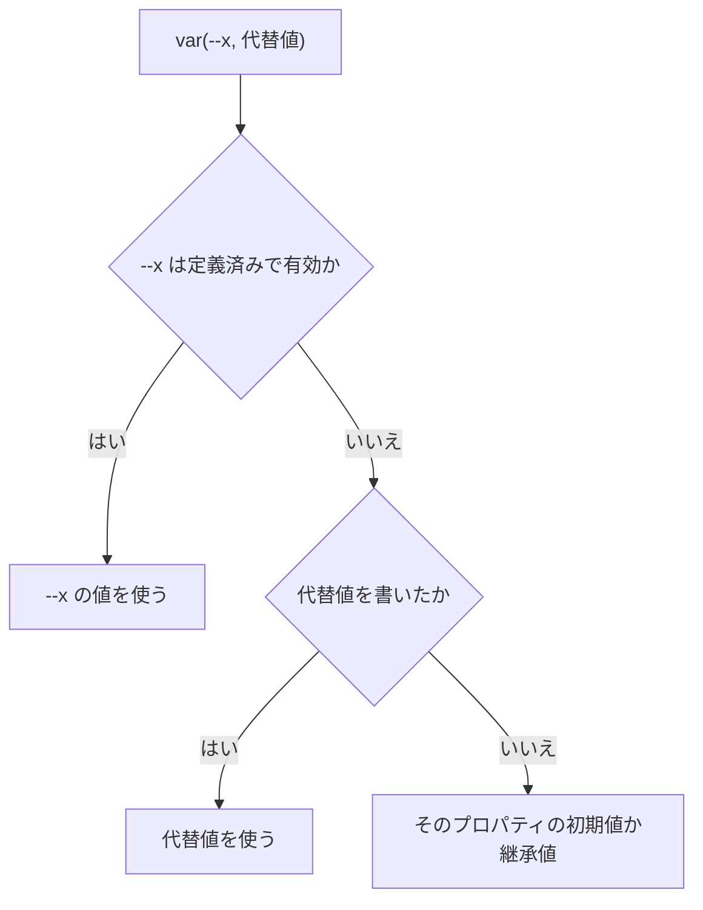

# デザイントークンと CSS カスタムプロパティ

色・余白・文字などのデザイン上の値は、直書きせずに名前を付けて一か所で管理する。
要点は「デザイントークンは名前と値の組である」「CSS では `--` で始まるカスタムプロパティに定義して `var()` で参照する」「継承・フォールバック・無効な値の扱いを知って使う」ことである。
内容は MDN の Using CSS custom properties と、Design Tokens Community Group の Design Tokens Format Module（preview draft）にもとづく。

## 値に名前を付ける理由

- 複雑なサイトでは同じ値（例: 同じ色）が何百か所にも現れる。
  変えるには全ルールの検索と置換が要る。
- 値を一か所で定義して複数の場所から参照すれば、変更は一か所で済む。
- `#00ff00` より `--main-text-color` のほうが意味が分かりやすい。
- デザイントークンは、この「名前と値の組」を、デザイン上の決定としてプラットフォームに依存しない形で表す手法である。
  最小限は `color-text-primary: #000000;` のような組である。

## デザイントークンの形式の基本

Design Tokens Format Module は、ツール間でトークンを受け渡すための JSON ファイル形式を定める。
ただし Draft Community Group Report であり、W3C 標準ではない。
原典は、この版を実装せず、権威ある根拠としても参照しないよう求めている。
ここでは形式の考え方だけを押さえる。

- `$value` を持つオブジェクトがトークンで、親のキーが名前になる。
- `$value` を持たないオブジェクトがグループで、トークンや入れ子のグループを入れる整理用の入れ物である。
  グループは参照できず、ツールはグループから型や用途を推測してはならない。
- `$type` で値の型（`color`、`dimension`、`fontFamily`、`duration` など）を示す。
  省略すると、参照先の型か、最も近い親グループの `$type` を受け継ぐ。
- 名前には `$`、`{`、`}`、`.` を使えない。
  `$` はこの仕様のプロパティの接頭辞で、後者 3 つは参照の構文に使うためである。

```json
{
  "color": {
    "$type": "color",
    "blue": { "$value": "..." },
    "accent": { "$value": "{color.blue}" }
  },
  "size": {
    "gap": { "$type": "dimension", "$value": { "value": 16, "unit": "px" } }
  }
}
```

この例の `color.accent` は、波括弧の構文で `color.blue` を参照するエイリアスである。
`color` の値の形は別の Color module が定めるため、`"..."` で省略している。

### エイリアスで値の重複をなくす

- トークンは、明示した値の代わりに別のトークンを参照できる。
  参照は値の繰り返しをなくし、関連する値の一貫性を保つために使う。
- 波括弧の構文 `{colors.blue}` は完全なトークンを指し、対象の `$value` に解決される。
- 参照が別の参照を指す連鎖も許され、明示した値までたどる。
- 参照は循環してはならず、ツールは検出してエラーにしなければならない。

### 複合トークン

影や文字の組みなどは、複数の部分値でできた複合トークンで表す。
`shadow`、`border`、`transition`、`gradient`、`typography` などがある。
部分値は、明示した値でも、同じ型の別のトークンへの参照でもよい。
複合トークンはそれ自体が 1 つのトークンなので、ほかのトークンから参照できる。

## CSS で実装する: カスタムプロパティ

CSS でトークンに当たるものが、カスタムプロパティ（CSS 変数）である。
Design Tokens Format Module が CSS への変換方法を定めているわけではない。
ここでは MDN にもとづき、CSS 側の仕組みを説明する。

### 宣言する

`--` に続けて名前を書き、値には有効な CSS の値なら何でも指定できる。

- ルールセットの中に書き、セレクターが使える範囲（スコープ）を決める。
- 全体から参照できるよう、`:root` に定義するのが一般的である。
  `:root` の宣言は、プロジェクト全体で値を変えるときの一か所の正本になる。
- 名前は大文字・小文字を区別する。

```css
:root {
  --main-bg-color: brown;
}
```

### `var()` で参照する

```css
details {
  background-color: var(--main-bg-color);
}
```

- `var()` は、要素のどのプロパティの値の、どの部分にも使える。
- プロパティ名やセレクターなど、値以外には使えない。
- 変数は、メディアクエリやコンテナクエリの中では動かない。

## 継承の仕組み

`--` で定義したカスタムプロパティは、常に親の値を継承する。
値は使われる場所で計算され、スタイルシートの別の場所で使うために保存されるわけではない。

- 設定した要素とその子孫だけが、その値を受け取る。
- 兄弟要素の子孫のルールから、ある要素の値を取り出すことはできない。
- 一致するセレクターで再定義すれば、その範囲だけ値を差し替えられる。

`@property` at-rule で定義すると、型（`syntax`）、初期値、継承するかどうか（`inherits`）を指定できる。
`inherits: false` なら、子は親の値ではなく初期値を使う。

```css
@property --logo-color {
  syntax: '<color>';
  inherits: false;
  initial-value: #c0ffee;
}
```

## 未定義や無効な値に備える



### `var()` のフォールバック

- 第 2 引数が、参照先が未定義か無効なときの代わりの値になる。
- 最初のカンマ以降のすべてが第 2 引数である。
  `var(--foo, red, blue)` のフォールバックは `red, blue` になる。
- 別のカスタムプロパティを代替にするときは、`var()` を入れ子にする。
  `var(--my-var, --my-background, pink)` では `--my-background, pink` 全体が 1 つの値になり、意図どおりに動かない。
- 入れ子の変数をたどるのに時間がかかるので、性能に注意する。
- フォールバックは、カスタムプロパティに未対応のブラウザへの互換性の対策ではない。

```css
.card {
  color: var(--my-var, var(--my-background, pink));
}
```

### 無効な値の扱い

- 通常のプロパティでは、無効な値の宣言は捨てられる。
- カスタムプロパティは、解析の時点では使われる場所が分からず、ほぼすべての値が有効とみなされる。
  無効かどうかは、使われる場所で計算するときに決まる。
- 計算時に無効な `var()` の置換に出会うと、そのプロパティの初期値か継承値が使われる。
  例: `--text-color: 16px` を `color: var(--text-color)` で使うと、`color` は継承元がなければ初期値（黒）になる。
- `@property` で `syntax` と `initial-value` を定義すると、型に合わない値のときに初期値が適用され、予期しない結果を防げる。

## JavaScript から読み書きする

カスタムプロパティの値は、標準のプロパティと同じ API で扱える。

```js
// インラインスタイルから取得
element.style.getPropertyValue('--my-var');

// 計算済みスタイルから取得（どこで定義された値でも読める）
getComputedStyle(element).getPropertyValue('--my-var');

// インラインスタイルに設定
element.style.setProperty('--my-var', jsVar + 4);
```

JavaScript で定義して扱うための API として、CSS Properties and Values API がある。

## See also

- [MDN: Using CSS custom properties 要約](/references/frontend/css/mdn-using-css-custom-properties.md)
- [Design Tokens: Design Tokens Format Module 要約](/references/frontend/css/design-tokens-format.md)
