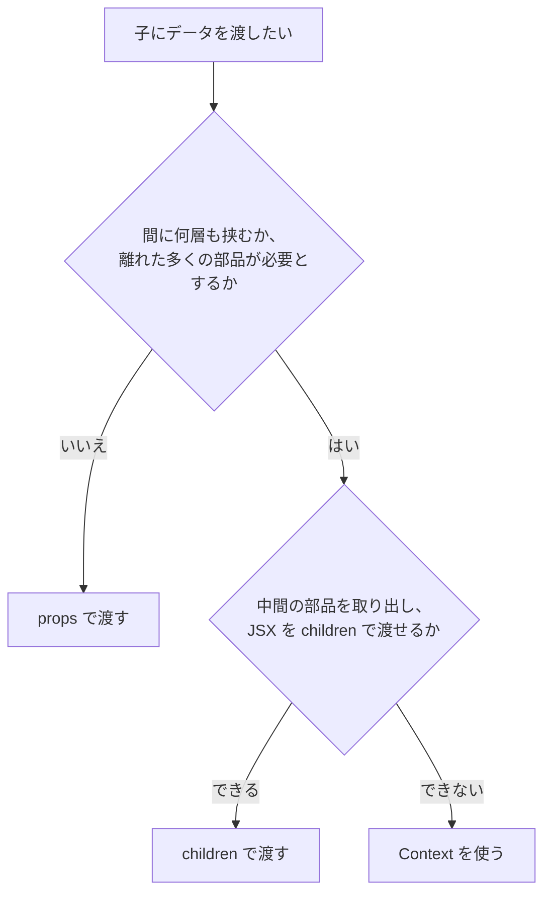

# React の部品の組み立て方

コンポーネントどうしは、props と Context でデータをやり取りして組み立てる。
要点は「まず props で渡す」「枠になる部品は `children` で中身を受け取る」「それでも遠くへ渡すときだけ Context を使う」ことである。
内容は React 公式ドキュメントの Passing Props to a Component と Passing Data Deeply with Context にもとづく。

## どの方法で渡すか



- Context は使いたくなりやすく、使いすぎやすい。
  props を何階層か深く渡すからといって、Context に入れるべきとは限らない。
- props で渡すと、どの部品がどのデータを使うかが明示され、保守しやすい。
- 先に props、次に `children` を試し、どちらもうまくいかないときに Context を検討する。

## props で渡す

- 親は、子に props を渡して情報を伝える。
- props は HTML の属性に似ているが、オブジェクト、配列、関数を含む任意の JavaScript の値を渡せる。
- props を使うと、親と子を独立に考えられる。
  親は子の使い方を知らずに値を変えられ、子は親を見ずに props の使い方を変えられる。

### 読み方

- 子では、関数の引数を分割代入して props を読む。
- コンポーネントの関数は `props` オブジェクトを 1 つだけ受け取る。
  通常は `props` 全体ではなく、個々の props に分割代入して使う。
- 関数名の直後の `(` と `)` の内側にある `{` と `}` を落とさない。

```tsx
function Avatar({ person, size }) {
  // person と size を変数のように使える
}
```

### 既定値

- 値が指定されないときの既定値は、分割代入の中で引数の直後に `=` と値を書いて指定する。
- 既定値が使われるのは、props が渡されないときと、`size={undefined}` が渡されたときだけである。
- `size={null}` や `size={0}` を渡した場合、既定値は使われない。

```tsx
function Avatar({ person, size = 100 }) {
  // ...
}
```

### スプレッド構文での転送

- 受け取った props をそのまま子に 1 つずつ渡すコードは、繰り返しになる。
  繰り返しは悪いとは限らず、読みやすいこともある。
- 簡潔さを重視するなら、すべてを転送するコンポーネントで `<Avatar {...props} />` と書ける。
- スプレッド構文は控えめに使う。
  あらゆるコンポーネントで使っているなら、何かがおかしい。
  コンポーネントを分割して、`children` を JSX として渡すべきだというサインであることが多い。

## children で JSX を渡す

- JSX のタグの中に内容を入れ子にすると、親コンポーネントはその内容を `children` という props で受け取る。
- 受け取る側（例: `Card`）は、中に何が描画されるかを知る必要がない。
  `<Avatar />` をテキストに置き換えても、そのまま包める。
- `children` を持つコンポーネントは、親が任意の JSX で埋められる「穴」を持つものと考えられる。
- パネルやグリッドなど、見た目のラッパーによく使われる。

```tsx
function Card({ children }) {
  return <div className="card">{children}</div>;
}

<Card>
  <Avatar />
</Card>;
```

### 中間の部品を取り出す

- データを使わず、下へ渡すだけの中間コンポーネントを何層も通すなら、途中でコンポーネントの取り出しを忘れていることが多い。
- 例えば、`posts` を直接使わない `<Layout posts={posts} />` に渡すのをやめる。
  `Layout` が `children` を受け取り、`<Layout><Posts posts={posts} /></Layout>` と描画する。
- データを指定する部品と、それを必要とする部品の間の層が減る。

## props は変わるが、変更はしない

- コンポーネントは、時間とともに異なる props を受け取ることがある。
  props は、ある時点でのコンポーネントのデータを反映する、読み取り専用のスナップショットである。
- props は不変で、子の中では変更できない。
- ユーザーの操作や新しいデータに応じて変える必要があるときは、親に新しい props を渡すよう頼む。
  古い props は捨てられ、そのメモリは JavaScript エンジンがいずれ回収する。
- 「props を変えよう」とはせず、入力に応えるときは state を設定する。

## prop drilling と Context

- props は、データを使う部品まで木を通して明示的に渡せる優れた方法である。
- 木の深くまで渡す必要があるとき、または多くの部品が同じ props を必要とするときは、冗長で不便になる。
  最も近い共通の祖先が、データを必要とする部品から遠いことがある。
  そこまで state を持ち上げると、prop drilling と呼ばれる状況になりうる。
- Context は、親が下の木全体へ、props を渡さずにデータを提供する仕組みである。
  木の深さに関係なく、任意の部品が使える。

## Context の使い方

Context は「作る」「使う」「提供する」の 3 段階で使う。
例は、見出しの大きさ `level` を、最も近い `Section` から `Heading` へ渡す場合である。

1. 作る。
   `createContext` を呼び、export する。
   引数は既定値 1 つだけで、オブジェクトを含め、どんな値でもよい。
1. 使う。
   データを必要とする部品で、`useContext(MyContext)` を呼んで読む。
1. 提供する。
   データを指定する部品が、子を `<MyContext value={...}>` で包む。

```tsx
// 1. 作る
export const LevelContext = createContext(1);

// 2. 使う
function Heading({ children }) {
  const level = useContext(LevelContext);
  // level に応じて h1, h2, ... を描画する
}

// 3. 提供する
function Section({ level, children }) {
  return <LevelContext value={level}>{children}</LevelContext>;
}
```

- `useContext` はフックである。
  `useState` や `useReducer` と同じく、コンポーネントの直下でだけ呼べる（ループや条件の中では呼べない）。
- 部品は、木の上で最も近いプロバイダの値を使う。
- 提供しなかった場合、React は `createContext` に渡した既定値を使う。
  例では、すべての見出しが `<h1>` になる。

### 間の部品を通り抜ける

- 異なる Context は互いを上書きしない。
  上から来る Context を上書きするには、異なる値のプロバイダで子を包む。
- 提供する部品と使う部品の間には、組み込みの `<div>` も自作の部品も、好きなだけ挟める。
- 同じ部品を異なる入れ子の深さで描画しても、中の部品は最も近いプロバイダから値を得る。
  描画される場所によって、表示が変わる「周囲に適応する」部品を書ける。

## Context の使いどころ

- テーマ: ダークモードのように見た目を変えるアプリでは、アプリの最上部にプロバイダを置き、見た目を調整する部品が使う。
- 現在のアカウント: 多くの部品がログイン中のユーザーを知る必要がある。
  複数のアカウントを同時に操作できるなら、UI の一部を別の値のプロバイダで包むと便利なことがある。
- ルーティング: 多くのルーティングの仕組みは、現在のルートを持つために内部で Context を使う。
  各リンクが自分が有効かどうかを知っているのは、このためである。
- 状態の管理: 離れた多くの部品が木の上のほうの state を変更したくなるときは、reducer と Context を組み合わせることが多い。
- Context は静的な値に限らない。
  次の描画で別の値を渡すと、React はそれを読む下の部品をすべて更新する。
  このため、state と組み合わせて使われることが多い。

## See also

- [React: Passing Props to a Component 要約](/references/frontend/react/react-passing-props-to-a-component.md)
- [React: Passing Data Deeply with Context 要約](/references/frontend/react/react-passing-data-deeply-with-context.md)
