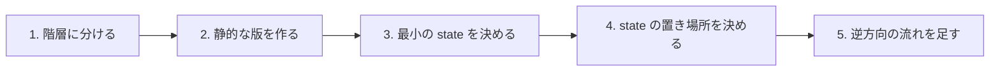
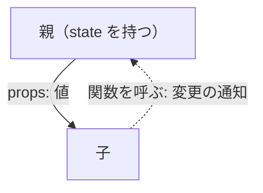

# React の state の持ち主とデータの流れ

state は、変更の責任を持つ 1 つのコンポーネントだけが持ち、ほかのコンポーネントへは props で渡す。
子から変更したいときは、親が更新用の関数を props として渡す。
内容は React 公式ドキュメントの Thinking in React と Sharing State Between Components にもとづく。

## 全体の手順

Thinking in React は、UI を作るときに次の 5 つの手順を踏むとしている。



- 手順 1 と 2 は、データを描画するだけの部分である。
- 手順 3 から 5 が、「何を state にするか」「誰が持つか」「どう変更するか」を決める部分であり、この文書の中心である。
- state の形そのものの整え方は [React の state の持ち方](/knowledge/frontend/react/react-state-structure.md) を参照する。

## 手順 1・2: 階層に分け、まず静的な版を作る

- UI をコンポーネントの階層に分ける。
  分け方の目安は、プログラミングなら「1 つのことだけを扱う」（関心の分離）、CSS ならクラスを付けたくなる単位、デザインならレイヤーの整理である。
- よく構造化されたデータは、UI の構造に自然に対応することが多い。
  コンポーネントは、データモデルの 1 つの部分に対応させる。
- 静的な版では、props だけでデータを親から子へ渡し、state は使わない。
  state は、時間とともに変わるデータのために取っておく。
- 静的な版を先に作るのは、たくさん打つが考えることは少ないからである。
  対話を足すのは、たくさん考えるが打つことは少ない。
- 階層の最上位がデータモデルを props で受け取り、データが木の下へ流れる。
  これを一方向のデータフロー（one-way data flow）と呼ぶ。

## 手順 3: state にするものを最小にする

- state は、アプリが覚えておく必要のある、変化するデータの最小の集まりと考える。
  守る原則は DRY（Don't Repeat Yourself）である。
  最小の表現だけを state にし、それ以外は必要なときに計算する。
- 次の問いで、state ではないものを見分ける。

  | 問い                                   | 答えが「はい」のとき |
  | :------------------------------------- | :------------------- |
  | 時間が経っても変わらないか             | state ではない       |
  | 親から props で渡されているか          | state ではない       |
  | 既存の state や props から計算できるか | state ではない       |

- 残ったものが、おそらく state である。
- 例: 商品の元の一覧は props で渡されるので state ではない。
  検索の文字列とチェックボックスの値は、変わるし計算もできないので state である。
  絞り込んだ一覧は、元の一覧と 2 つの値から計算できるので state ではない。
- props と state の違い:
  - props は、関数の引数のようなものである。
    親が子にデータを渡し、見た目を調整できる。
  - state は、コンポーネントの記憶のようなものである。
  - 両者は一緒に働く。
    親が state に情報を持ち、それを子に props として渡すことがよくある。

## 手順 4: state を置く場所を決める

state を変える責任を持つコンポーネントを、その state を持つ（own する）コンポーネントと呼ぶ。
state の 1 つひとつについて、次の順で置き場所を決める。

1. その state に基づいて何かを描画するコンポーネントを、すべて見つける。
1. それらの最も近い共通の親を見つける。
1. 置き場所を決める。
   1. 多くの場合は、共通の親に直接置く。
   1. 共通の親より上のコンポーネントに置くこともできる。
   1. ふさわしいコンポーネントがなければ、state を持つためだけのコンポーネントを、共通の親より上に新しく作る。

- 例: 検索の文字列を使うのは、絞り込む `ProductTable` と、表示する `SearchBar` である。
  この 2 つが共有する最初の親は `FilterableProductTable` なので、state はそこに置く。

```tsx
function FilterableProductTable({ products }: { products: Product[] }) {
  const [filterText, setFilterText] = useState('');
  const [inStockOnly, setInStockOnly] = useState(false);
  // filterText と inStockOnly を SearchBar と ProductTable に props で渡す
}
```

## 兄弟の state をそろえる: state の持ち上げ

2 つのコンポーネントの state を、常に一緒に変えたいことがある。
そのときは、両方から state を取り除き、最も近い共通の親へ移し、props で渡す。
この操作を state の持ち上げ（lifting state up）と呼び、React で最もよく行う操作の 1 つである。

持ち上げは次の 3 つの手順で行う。

1. 子から state を取り除く。
   state の宣言を消し、代わりにその値を子の props に加える。
   子は、その値を自分では制御できなくなる。
1. 共通の親から、固定値のデータを渡す。
   連動させたい子すべての上にある最も近い親が、情報源（source of truth）になる。
1. 共通の親に state を追加し、イベントハンドラと一緒に渡す。

```tsx
const [activeIndex, setActiveIndex] = useState(0);

<Panel isActive={activeIndex === 0} onShow={() => setActiveIndex(0)} />;
<Panel isActive={activeIndex === 1} onShow={() => setActiveIndex(1)} />;
```

- 持ち上げると、state として持つものの性質が変わることが多い。
  例では、各 `Panel` の真偽値を 2 つ持つ代わりに、開いている `Panel` の番号を 1 つ持つ。
  これで、同時に開くのが 1 つだけになることが保証される。
- 親が `onShow` のようなイベントハンドラを props として渡すことで、子が親の state を変えられる。

## 子から親へ変更を伝える: 逆方向のデータの流れ

- state を持つのは 1 つのコンポーネントだけなので、`setFilterText` などを呼べるのもそのコンポーネントだけである。
  深いところにあるフォームから更新したいときは、これらの関数を props として子に渡す。
- 子では、`onChange` のイベントハンドラから、受け取った関数を呼ぶ。

```tsx
<input type="text" value={filterText} onChange={(e) => onFilterTextChange(e.target.value)} />
```

- `value` を渡して `onChange` を渡さないと、入力欄は変わらない。
  `value` が常に親から渡された値に等しいので、親が state を更新するまで表示が変わらないためである。
  `onChange` がないと、読み取り専用になるという警告もコンソールに出る。
- 流れは、データが props で下へ、変更の通知が関数の呼び出しで上へ、と明示的になる。
  双方向データバインディングより、少し多く打つ必要がある。



## 制御されたコンポーネントと制御されていないコンポーネント

- 制御されていない（uncontrolled）: ローカルな state を持つコンポーネント。
  親は振る舞いに影響できない。
  設定が少なくて済むので親の中で使いやすいが、複数をまとめて連動させる柔軟性は低い。
- 制御された（controlled）: 重要な情報が、ローカルな state ではなく props で決まるコンポーネント。
  親が振る舞いを完全に指定できる。
  最大限に柔軟だが、親が props ですべてを設定する必要がある。
- この 2 つは厳密な技術用語ではない。
  多くのコンポーネントは、ローカルな state と props の両方を、ある程度ずつ持つ。
- コンポーネントを書くときは、どの情報を props で制御し、どの情報を state で制御しないかを考える。
  あとから考えを変えて、書き直してもよい。

## state ごとに 1 つの情報源

- 1 つの state の持ち主は、1 つのコンポーネントにする。
  連動させたい値を複数の場所に別々の state で持たず、共通の親を情報源にして props で配る。
- state は、入力欄のように木の末端に近いところにも、アプリの上のほうにも置かれる。
  クライアント側のルーティングのライブラリも、多くは現在のルートを React の state に保存し、props で渡している。
- state の置き場所を探る間は、下へ移したり、また上へ戻したりすることがよくある。
  これも作業の一部である。

## See also

- [React: Thinking in React 要約](/references/frontend/react/react-thinking-in-react.md)
- [React: Sharing State Between Components 要約](/references/frontend/react/react-sharing-state-between-components.md)
- [React の state の持ち方](/knowledge/frontend/react/react-state-structure.md)
- [React の画面の切り替えと state のリセット](/knowledge/frontend/react/react-state-reset-by-position.md)
