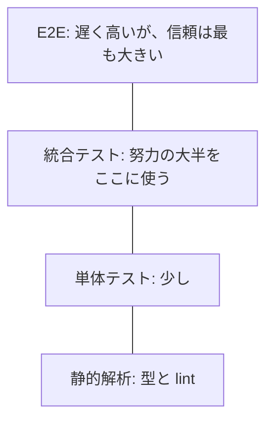

# フロントエンドのテストの考え方

テストは、ソフトウェアが使われる方法にできるだけ似せて書く。
要点は「実装の詳細ではなく利用者から見える振る舞いを確かめる」「テストの努力は統合テストに最も多く使う」「要素は利用者が見つける手段に近いクエリで探す」ことである。
内容は Kent C. Dodds の 2 本の記事と、Testing Library の公式ドキュメントにもとづく。

## 利用者と同じ使い方でテストする

テストが使われ方に似ているほど、テストは大きな確信を与える。
Testing Library は、この考え方に沿って、Web ページが実際に使われる方法に近いテストを促すメソッドだけを公開しようとしている。

テストを書く前に、まず「このコードの利用者は誰か」を決める。
React のコンポーネントには、通常 2 種類の利用者がいる。

- エンドユーザーは、描画されたボタンや内容を見て操作する。
- 開発者は、コンポーネントに Props を渡して描画する。

したがって、テストが見たり操作したりするのは、Props と描画結果だけにする。
利用者と違う使い方をするテストは、誰も気にかけない第 3 の利用者を作ることになり、無駄である。

何をテストするかに迷ったら、次の手順で決める。

1. テストのないコードのうち、壊れたらとても困る部分を考える（例: 購入手続き）。
1. それを 1 つか少数の単位に絞る（例: 「購入」ボタンを押すと、カートの中身を載せたリクエストが送られる）。
1. そのコードの利用者が誰かを考える。
1. その利用者が手作業で動作を確かめる手順を書き出す。
1. その手順を自動テストにする。

## 実装の詳細をテストしない

実装の詳細とは、コードの利用者が通常は使わず、見ず、知りもしないものである。
state の名前、内部メソッド、子コンポーネントの名前や Props がこれにあたる。

実装の詳細をテストすると、次の 2 つの問題が起きる。
ここでの陽性は「テストが通る」、陰性は「テストが失敗する」ことである。

- 偽陰性は、動いているのにテストが失敗することである。
  リファクタリングで state の名前や構造を変えただけで、テストが壊れる。
- 偽陽性は、壊れているのにテストが通ることである。
  state の更新だけを調べていると、ボタンがハンドラに正しくつながっていないバグを見逃す。

利用者から見える振る舞いだけを確かめるテストは、どちらも避けられる。
アコーディオンを例にすると、次の流れで 1 つのテストにできる。

```tsx
render(<Accordion items={items} />);
expect(screen.getByText(items[0].contents)).toBeInTheDocument();
expect(screen.queryByText(items[1].contents)).not.toBeInTheDocument();

await user.click(screen.getByText(items[1].title));
expect(screen.getByText(items[1].contents)).toBeInTheDocument();
expect(screen.queryByText(items[0].contents)).not.toBeInTheDocument();
```

このテストは、state の名前が何であっても通る。
クリックハンドラのつなぎ方を間違えれば失敗する。
クラスコンポーネントからフックを使う関数コンポーネントへ移行しても、そのまま動く。

Testing Library の指針も、同じ方向を向いている。
描画に関わるユーティリティは、コンポーネントのインスタンスではなく DOM ノードを扱う。

## どの種類のテストをどれだけ書くか

記事が挙げる種類は、単体テスト、統合テスト、E2E の 3 つである。
Testing Trophy では、これに静的解析（TypeScript や ESLint）を土台として加える。



- 上の種類ほど、書くのも実行するのも遅く、費用が増える。
  一方で、各テストが与える信頼も増える。
  テストピラミッドは前者だけを示し、後者を示していない。
- 型や lint でも、かなりの信頼は得られる。
  ただし、ビジネスロジックの不具合がないことは保証できない。
- 統合テストは、信頼と、速さ・費用のトレードオフの均衡がよい。
  部品が単独で動くだけでなく、一緒に正しく動くことを確かめる必要があるためである。
  一緒に動くことをテストすれば、単独のテストは不要になることが多い。
- 統合テストを増やすには、モックを使いすぎない。
  モックにした部分との統合についての信頼は、すべて失われる。
  浅い描画（shallow rendering）も同じである。
  メールの送信や課金のように、モックが避けられない場合は使う。
- 記事は、層ごとの配分の数字を挙げていない。
  述べているのは「統合テストに最も力を注ぐ」ことだけである。

書きすぎにも注意する。
カバレッジが 70% 程度（著者自身が「根拠のない数字」と断っている）を大きく超えると、見返りは逓減する。
100% を課すと、ロジックのないコードまでテストし、再現しにくい 1 行のために実装の詳細をテストしてしまう。
リファクタリングでテストを直す必要があるのは、ごくまれであるべきである。

## Testing Library のクエリを選ぶ

### 優先順位

クエリは、利用者が要素を見つける方法に近い順に選ぶ。
上から検討し、取れないときだけ下に進む。

1. 全員が使えるクエリ（視覚とマウスで使う人にも、支援技術を使う人にも共通する）。
   1. `getByRole`: ほとんどあらゆる場面で第一の選択肢である。
      `name` でアクセシブルネームを指定して絞り込む（例: `getByRole('button', { name: /submit/i })`）。
      これで取れないなら、UI がアクセシブルでない可能性がある。
   1. `getByLabelText`: フォームの入力欄に向く。
      利用者がラベルの文字で入力欄を見つける動きを再現する。
   1. `getByPlaceholderText`: ラベルの代わりにはならない。
      ほかに手段がないときだけ使う。
   1. `getByText`: フォームの外で、操作しない要素（div、span、段落）を探す主な手段である。
   1. `getByDisplayValue`: 入力済みのフォーム要素を、現在の値で探す。
1. セマンティッククエリ（ブラウザーや支援技術によって体験が大きく異なる）。
   1. `getByAltText`: `alt` を持つ要素を探す。
   1. `getByTitle`: スクリーンリーダーで一貫して読み上げられず、既定では目にも見えない。
1. テスト ID。
   1. `getByTestId`: 利用者には見えず聞こえない。
      role やテキストで探せない、またはテキストが動的で意味をなさない場合にだけ使う。

クラスや id を `querySelector` で探す方法は勧められない。
これらは利用者には見えないためである。
どうしても必要なら、テスト ID を使う。
非セマンティックな手段に頼っていることを明示でき、HTML に安定した取り決めを作れる。

### getBy・queryBy・findBy の使い分け

| 種類         | 0 件   | 1 件 | 2 件以上 | 再試行 | 主な使いどころ                 |
| :----------- | :----- | :--- | :------- | :----- | :----------------------------- |
| `getBy...`   | エラー | 要素 | エラー   | なし   | 今ある要素を取る               |
| `queryBy...` | `null` | 要素 | エラー   | なし   | 要素が存在しないことの検証     |
| `findBy...`  | エラー | 要素 | エラー   | あり   | 少し後に現れる要素を待って取る |

- 複数の要素を扱うときは、`getAllBy...`、`queryAllBy...`、`findAllBy...` を使う。
- `findBy` は `getBy` と `waitFor` を組み合わせたもので、既定のタイムアウトは 1000ms である。

### screen を使う

`document.body` 全体から探すなら、`screen` を使うことが推奨される。
`container` を毎回渡す必要がなく、描画した結果を一貫した書き方で問い合わせられる。
React Testing Library も `screen` を再エクスポートしている。

## See also

- [Kent C. Dodds: Testing Implementation Details 要約](/references/frontend/testing/kentcdodds-testing-implementation-details.md)
- [Kent C. Dodds: Write tests. Not too many. Mostly integration. 要約](/references/frontend/testing/kentcdodds-write-tests.md)
- [Testing Library: Guiding Principles 要約](/references/frontend/testing/testing-library-guiding-principles.md)
- [Testing Library: About Queries 要約](/references/frontend/testing/testing-library-queries.md)
- [テスト設計における AAA パターン](/knowledge/coding/aaa-pattern.md)
- [コードを書くときに意識すること](/knowledge/coding/coding-mindset.md)
