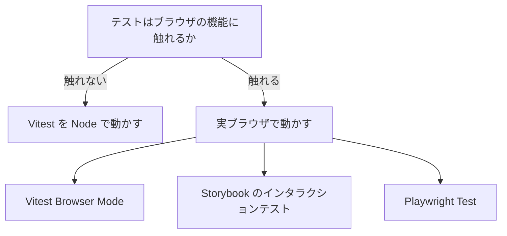

# フロントエンドのテストの道具の使い分け

フロントエンドのテストの道具は、テストをどこで動かすか、何を単位に書くかが違う。
ここでは Vitest、Vitest Browser Mode、Storybook のインタラクションテスト、Playwright Test の 4 つを、各資料に書かれていることだけで整理する。
何をどの粒度でテストするかという戦略は、[フロントエンドのテスト戦略](/knowledge/frontend/testing/frontend-testing-strategy.md)で扱う。

## 4 つの道具の役割

### Vitest

- Vite を土台にしたテストフレームワークである。
- `.test.` か `.spec.` を含む名前のファイルにテストを書き、`expect` と `test` で検証する。
- 設定は既定で `vite.config.*` を読むので、既存の Vite のプラグインや設定をそのまま使える。
- Browser Mode の資料では、Node ベースのランナーで動かすテストを `environment: 'node'` のプロジェクトとして定義している。

```ts
import { expect, test } from 'vitest';
import { sum } from './sum.js';

test('adds 1 + 2 to equal 3', () => {
  expect(sum(1, 2)).toBe(3);
});
```

### Vitest Browser Mode

- Vitest のテストを、Node ではなくブラウザの中でネイティブに実行する機能である。
- `window` や `document` といったブラウザのグローバルを使える。
- 部品の描画には `vitest-browser-react` などのパッケージを使う。
  操作には `vitest/browser` の `userEvent`、検証には `expect.element` を使う。
- 有効にするには、`browser.enabled` を `true` にし、プロバイダーと `instances` を指定する。
  プロバイダーは `preview`、`playwright`、`webdriverio` から選ぶ。

```ts
export default defineConfig({
  test: {
    browser: {
      provider: playwright(),
      enabled: true,
      instances: [{ browser: 'chromium' }],
    },
  },
});
```

### Storybook のインタラクションテスト

- ストーリーの一部としてテストを書く。
  ストーリーが props と context を与えて部品を初期状態で描画し、`play` 関数が操作と検証を担う。
- `play` 関数には `canvas`、`userEvent` などが渡される。
  - `canvas` は、テスト対象のストーリーを含む要素で、Testing Library のクエリ（`findByRole` など）で探す。
  - `userEvent` でクリックや入力を再現する。
  - `expect` は `storybook/test` から import する。
    Vitest の `expect` と `@testing-library/jest-dom` のマッチャーを合わせたものである。
  - `userEvent` と `expect` は、Interactions パネルでの記録とデバッグのために必ず `await` する。
- 流れが複雑なときは `step` で関連する操作をまとめ、パネルに折りたためるグループとして表示できる。
- 描画だけを調べる簡易版は、すべてのストーリーに使える描画テスト（render test）である。

```tsx
export const FilledForm: Story = {
  play: async ({ canvas, userEvent }) => {
    await userEvent.type(canvas.getByLabelText('Email'), 'a@example.com');
    await userEvent.click(canvas.getByRole('button', { name: 'Log in' }));
    await expect(canvas.getByText('Submitted')).toBeInTheDocument();
  },
};
```

### Playwright Test

- モダンな Web アプリ向けの E2E（エンドツーエンド）テストのフレームワークである。
- テストランナー、アサーション、テスト間の分離、並列実行、ツール群をまとめて備える。
- Chromium、WebKit、Firefox を、ローカルでも CI でも、ヘッドレスでもヘッドありでも動かせる。
- 結果は HTML レポーターで確認する。
  UI モード（`--ui`）では、ウォッチモード、ステップのライブ表示、タイムトラベルデバッグが使える。

## 比較表

| 観点             | Vitest                                   | Vitest Browser Mode                                      | Storybook のインタラクションテスト       | Playwright Test                     |
| :--------------- | :--------------------------------------- | :------------------------------------------------------- | :--------------------------------------- | :---------------------------------- |
| テストが動く場所 | Node（資料の例は `environment: 'node'`） | ブラウザの中（開発時は UI の中央の iframe）              | 実ブラウザ上の Storybook                 | Chromium、WebKit、Firefox           |
| 向いていること   | 一般的なテスト（`expect`、`test`）       | ブラウザのグローバルを使うテスト、部品の描画と操作の検証 | ストーリーに書く部品の操作と結果の検証   | 複数のブラウザにまたがる E2E テスト |
| 実行の方法       | `vitest`、一度だけなら `vitest run`      | `--browser=chromium`、`--browser.headless`               | Vitest アドオン（UI、エディタ、CLI、CI） | `npx playwright test`               |
| デバッグの手段   | （資料に記載なし）                       | UI、Trace View                                           | Interactions パネル                      | HTML レポート、UI モード            |
| テストを書く場所 | `.test.` か `.spec.` を含むファイル      | 同左（`vitest/browser` を使う）                          | ストーリーの `play` 関数                 | `tests/` のテストファイル           |

- 表の「Vitest」は、Browser Mode を有効にしない通常の実行を指す。
- Vitest と Storybook のインタラクションテストは別の道具だが、`expect` と `fn` に Vitest のものを使う点でつながっている。
  Storybook の資料は、インタラクションテストを「Vitest と Testing Library を Storybook に統合したもの」と説明している。
- 実行速度の比較は、4 つの資料のどれにも書かれていない。

## 実ブラウザで動かすかどうか

Vitest を Node で動かすか、実ブラウザで動かすかは、テストが何に触れるかで分かれる。



- Storybook の資料は、インタラクションテストの利点を「テスト対象の部品を実ブラウザで見られること」とする。
  コマンドラインに偽の DOM のダンプが出る状況や、JSDOM によるブラウザ機能のモックの限界を避けられる。
- Vitest Browser Mode にも、制約がある。
  - `alert`、`confirm`、`print` のようなスレッドを止めるダイアログは、ネイティブには使えない。
    これらの Web API は自分でモックすることが勧められている。
  - モジュールの export への `vi.spyOn` はエラーになる。
    回避策は `vi.mock('./module.js', { spy: true })` である。
- Storybook の資料は、すべての部品にインタラクションテストを適用すると保守に手間がかかるとする。
  視覚テストなどほかの方法と組み合わせると、保守の手間を抑えて広く確認できる。

## 実行方法の違い

- Vitest は、`package.json` の `scripts` に `"test": "vitest"` を書いて実行する。
  一度だけ実行するなら `vitest run`、フラグは `--reporter` や `--coverage` などを渡せる。
- Vitest Browser Mode は、`vitest init browser` で依存関係と設定を作れる。
  - 設定にブラウザ名がないまま `--browser` を指定すると失敗する。
  - ヘッドレスで動かすには `playwright` か `webdriverio` のプロバイダーが必要である。
  - CI で動かすにも、どちらかが必要である。
  - Node ベースのテストと混ぜるときは `projects` で設定を分ける。
- Storybook は、Vitest アドオンを使えば、UI の「Run component tests」ボタン、エディタ、CLI、CI のどれからでも実行できる。
  Vitest アドオンには Vite ベースのフレームワークが必要で、Webpack のプロジェクトは先に Vite へ移行する。
- Playwright Test は、`npm init playwright@latest` で設定とブラウザを入れ、`npx playwright test` で実行する。
  既定ではヘッドレスで、3 種類のブラウザにまたがって並列に動く。
  - `--headed` で画面を見る。
  - `--project=chromium` で 1 つのブラウザに絞る。
  - ファイルのパスを渡して、1 つのファイルだけ動かす。
  - `npx playwright show-report` で HTML レポートを開く。

## See also

- [Vitest: Getting Started 要約](/references/frontend/testing/vitest-getting-started.md)
- [Vitest: Browser Mode 要約](/references/frontend/testing/vitest-browser-mode.md)
- [Storybook: Interaction tests 要約](/references/frontend/testing/storybook-interaction-testing.md)
- [Playwright: Installation 要約](/references/frontend/testing/playwright-intro.md)
- [フロントエンドのテスト戦略](/knowledge/frontend/testing/frontend-testing-strategy.md)
