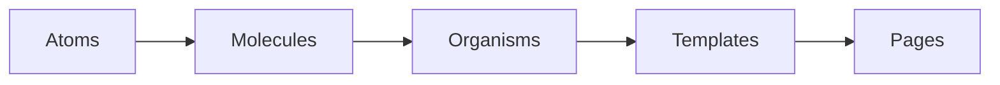

# UI 部品の分け方（Atomic Design）

UI の部品は、Atomic Design の 5 段階（atoms、molecules、organisms、templates、pages）で分類して考えられる。
5 段階は直線的な工程ではなく、部分と全体を行き来するための mental model（心の中のモデル）である。
内容は Brad Frost『Atomic Design』第 2 章にもとづく。

## 5 段階を使い分ける

インターフェースは、化学の原子・分子・有機体になぞらえて、有限の要素に分解できる。
最初の 3 段階は部品を組み立てる階層で、後ろの 2 段階は部品をページとして見る段階である。

| 段階      | 何か                                                   | 例                                                                   |
| :-------- | :----------------------------------------------------- | :------------------------------------------------------------------- |
| Atoms     | これ以上分けられない UI の要素。すべての UI の土台     | ラベル、入力欄、ボタン                                               |
| Molecules | 1 つのまとまりとして働く、比較的単純な部品の集まり     | ラベルと入力欄とボタンからなる検索フォーム                           |
| Organisms | 比較的複雑な部品。インターフェースの独立した区画になる | ロゴとナビゲーションと検索フォームを含むヘッダー、商品の格子状の一覧 |
| Templates | 部品をページのレイアウトに置き、内容の構造を示すもの   | ヘッダーの organism を当てはめたホームページの骨格                   |
| Pages     | template に代表的な内容を入れた具体的な実例            | 実際の商品名や画像を流し込んだ画面                                   |

## 部品の段階を決める

### Atoms

- 基本の HTML 要素にあたり、機能を保ったままではこれ以上分けられない。
- 単独では存在せず、使われて初めて生きる。
- 画像の寸法やフォントサイズなどの固有の性質を持ち、その性質が UI 全体での使い方に影響する。

### Molecules

- 抽象的だった atoms を組み合わせると、目的が生まれる。
  ラベルが入力欄を定義し、ボタンを押すと送信される。
- 検索が必要などこにでも置ける、単純で持ち運べて再利用できる部品になる。
- 単純な部品を作ると、単一責任の原則（do one thing and do it well）に従いやすい。
  1 つのパターンに複雑さを背負わせすぎると、扱いにくくなる。
  単純な molecules は、テストがしやすく、再利用され、UI の一貫性を高める。

### Organisms

- molecules、atoms、ほかの organisms の集まりからなる。
- 性質の異なる要素の集まり（ヘッダー）も、同じ molecule の繰り返し（商品の一覧）も organism になる。
- 小さな部品が実際に働く文脈を示し、何度も使える独立したパターンになる。
  商品の一覧の organism は、カテゴリ、検索結果、関連商品など、商品の集まりを表示するどこでも使える。

## templates と pages を使い分ける

templates と pages では、化学の比喩をやめる。
最終的な成果物は、顧客や上司や同僚に通じる言葉で語る必要があり、比喩を引っ張ると関係者を混乱させるおそれがあるためである。

### Templates

- 最終的な内容ではなく、土台にある内容の構造に注目する。
- 内容は動的に変わるので、画像の大きさや見出しの文字数などの部品の性質を明示するとよい。
- 骨格を定めると、さまざまな内容に対応しつつ、入る内容の種類に歯止めも与えられる。

### Pages

- 最も具体的な段階で、利用者が実際に目にして操作し、関係者が承認するものである。
- 実際の内容を当てはめて、パターンがうまく働くかを確かめる。
  問題があれば、molecules、organisms、templates に戻って直す。
- templates のバリエーションを明らかにする場でもある。
  - 買い物かごの商品が 1 つの利用者と 10 個の利用者がいる。
  - 記事の見出しが 40 文字のものも、340 文字のものもある。
  - 管理者の権限を持つ利用者には、追加のボタンが見える。
- バリエーションを考慮した pages を作ると、回復力のあるデザインシステムになる。

## 部分と全体を行き来する

- 最大の利点は、抽象と具体をすばやく行き来できることである。
  UI を atoms まで分解して見ることも、それらが組み合わさった最終的な体験を見ることも、同時にできる。
- 部品は全体に影響し、全体は部品に影響する。
  部品だけを単独で設計して、全体がまとまることを祈るのは愚かである。
- 部品を作るときは細部を描く画家のように、レイアウトの中で実際の内容と共に見るときは少し下がって全体を評価する画家のようにふるまう。
- そのため、5 段階を「手順 1 は atoms、手順 2 は molecules」のように解釈しない。
  最終的な UI とその土台のデザインシステムを同時に作るための mental model として捉える。

## 構造と内容を分ける

- デザインと内容は、どちらかが先ではなく「content and design」である。
- templates が内容の構造の骨格を、pages が最終的な内容を表すので、両者を明確に分けて語れる。
  ただし、両者が互いに強く影響し合うことも認めている。
- 例として、人名が molecule の中で 5 行に折り返すなら、より atoms に近い段階で直す必要がある。
  pages に流し込む内容は、土台のパターンの性質や範囲に影響する。

## 名前は組織に合わせる

- Atoms、molecules、organisms の名前は、基本的な化学の知識があれば階層を読み取れる。
  components や modules といった語は、名前だけでは階層を表さない。
- 一方で、名前を付けるのは難しく不完全であり、選んだ名前が合わなくてもかまわない。
- GE のデザインチームは、Atomic Design の分類が同僚に伝わりにくかったため、Principles、Basics、Components、Templates、Features、Applications という分類にした。
- 厳格な教義ではなく、組織が効果的に意思疎通できる分類を選ぶ。

## Web に限らない

- Atomic Design は Web から生まれたが、あらゆる UI に当てはまる。
  例として、モバイルアプリの Instagram を 5 段階に分解している。
  - Atoms: アイコン、文字レベルの要素、画像。
  - Molecules: 下部のナビゲーションバー、写真の操作バー。
  - Organisms: 利用者の情報、写真、操作、説明文を合わせた写真の部品。
- CSS や JavaScript の設計手法ではなく、使う技術によらず UI のデザインシステムを作るための考え方である。

## See also

- [Atomic Design: Chapter 2 Atomic Design Methodology 要約](/references/frontend/ui-design/atomic-design-chapter-2.md)
