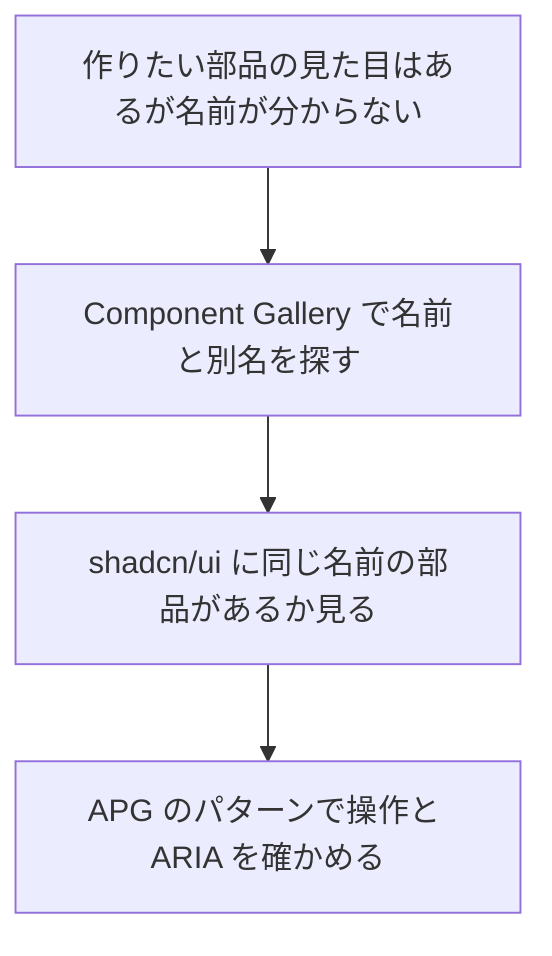

# 定番の UI 部品の名前と探し方

UI 部品を作るときは、まず名前を知り、次にコードの出発点を探し、最後にキーボード操作と ARIA を確かめる。
名前が分かれば、他の人が同じものをどう作ったかを検索できる。
内容は The Component Gallery、shadcn/ui、WAI-ARIA Authoring Practices Guide（APG）の 3 つの資料にもとづく。

## 3 つの資料の使い分け

目的ごとに見る資料が違う。

| 知りたいこと                         | 見る資料              | 資料が示すもの                                         |
| :----------------------------------- | :-------------------- | :----------------------------------------------------- |
| 部品の名前、別名、似た部品との違い   | The Component Gallery | 実在のデザインシステムから集めた部品の名前、別名、説明 |
| そのまま持ち込んで直せる部品のコード | shadcn/ui             | 部品のコードと、それを配布するスキーマと CLI           |
| キーボード操作、ロール、状態、ARIA   | WAI-ARIA APG          | ARIA の意味づけを一般的なパターンに適用する方法        |



- Component Gallery は、そのまま使える部品の集まりではない。
  自分の問題に合う解決策を設計するときの着想源になることを狙っている。
- 人気があるというだけで、その作り方が正しいとは限らない。
  Component Gallery 自身が、多数に流されず、可能なら調査に基づいて判断するよう注意している。

## 名前は揺れるので別名で探す

- 同じものが、デザインシステムごとに別の名前で呼ばれる。
  Component Gallery は別名を併記して、この揺れを一覧にしている。
- 迷ったときの出発点は、他の人が似たものを何と呼んでいるかを見ることである。

| 名前（Gallery）    | 別名                                             |
| :----------------- | :----------------------------------------------- |
| Modal              | Dialog、Popup、Modal window                      |
| Toast              | Snackbar                                         |
| Toggle             | Switch、Lightswitch、Toggle button               |
| Drawer             | Tray、Flyout、Sheet                              |
| Accordion          | Collapse、Collapsible、Disclosure、Expander など |
| Badge              | Tag、Label、Chip                                 |
| Combobox           | Autocomplete、Autosuggest                        |
| Progress indicator | Stepper、Steps、Timeline など                    |

- shadcn/ui や APG では、さらに別の名前になることがある。
  例: Gallery の Modal は shadcn/ui では Dialog、Gallery の Toggle は APG では Switch である。
- 検索するときは、1 つの名前に決め打ちせず、別名も試す。

## 似た部品の違い

Component Gallery の説明で、違いが述べられている組み合わせを挙げる。

| 比べる部品                         | 違い                                                                                             |
| :--------------------------------- | :----------------------------------------------------------------------------------------------- |
| Popover と Tooltip                 | Popover は通常クリックで開き、操作できる要素を含められる。Tooltip は通常ホバーで表示する         |
| Dropdown menu と Select            | Dropdown menu は操作やナビゲーションを示す。Select は値を選ぶフォーム入力である                  |
| Combobox と Select                 | Combobox は選択肢を絞り込む自由入力のテキストがある                                              |
| Toast と Alert                     | Toast は他の内容の上の層に現れる Alert の一種である                                              |
| Progress bar と Progress indicator | Progress bar は完了状況を連続的に示す。Progress indicator は離散的な段階のどこまで進んだかを示す |
| Segmented control                  | Button group、Radio button、Tabs の中間のような部品である                                        |

## 部品ごとに、どの資料に載っているか

3 つの資料の一覧に載っているかどうかだけを示す。
名前は資料ごとの表記で、別の名前で載っている場合は括弧で添える。
`-` は、その一覧に同じ名前の項目が見当たらないことを表す。

| 部品         | Component Gallery | shadcn/ui             | APG                                       |
| :----------- | :---------------- | :-------------------- | :---------------------------------------- |
| Accordion    | Accordion         | Accordion             | Accordion                                 |
| Alert        | Alert             | Alert                 | Alert                                     |
| ダイアログ   | Modal             | Dialog、Alert Dialog  | Dialog (Modal)、Alert and Message Dialogs |
| Drawer       | Drawer            | Drawer、Sheet         | -                                         |
| Popover      | Popover           | Popover               | -                                         |
| Tooltip      | Tooltip           | Tooltip               | Tooltip                                   |
| メニュー     | Dropdown menu     | Dropdown Menu         | Menu and Menubar、Menu Button             |
| Select       | Select            | Select、Native Select | -                                         |
| Combobox     | Combobox          | Combobox              | Combobox                                  |
| Checkbox     | Checkbox          | Checkbox              | Checkbox                                  |
| ラジオボタン | Radio button      | Radio Group           | Radio Group                               |
| オン/オフ    | Toggle            | Switch、Toggle        | Switch                                    |
| Slider       | Slider            | Slider                | Slider、Slider (Multi-Thumb)              |
| Tabs         | Tabs              | Tabs                  | Tabs                                      |
| Breadcrumb   | Breadcrumbs       | Breadcrumb            | Breadcrumb                                |
| Pagination   | Pagination        | Pagination            | -                                         |
| Toast        | Toast             | Sonner、Toast         | -                                         |
| Skeleton     | Skeleton          | Skeleton              | -                                         |
| Spinner      | Spinner           | Spinner               | -                                         |
| Table        | Table             | Table、Data Table     | Table                                     |
| Carousel     | Carousel          | Carousel              | Carousel (Slide Show or Image Rotator)    |
| Tree view    | Tree view         | -                     | Tree View                                 |
| Skip link    | Skip link         | -                     | -                                         |

- 載っていないことは、その部品が存在しないことを意味しない。
  あくまで、それぞれの一覧にその名前の項目が見当たらない、というだけである。
- APG にだけ載っている項目には、Landmarks、Feed、Window Splitter などがある。
  Gallery にだけ載っている項目には、Skip link、Visually hidden などがある。

## shadcn/ui の考え方

shadcn/ui は、コンポーネントライブラリではなく、コンポーネントライブラリを作るための方法である。
5 つの原則のうち、部品を選ぶときに関わるのは次の 3 つである。

- Open Code
  - 部品のコードを利用者に渡し、利用者が直接編集する。
  - 通常のライブラリのように、スタイルを上書きしたりコンポーネントを包んだりする必要がない。
  - 依存パッケージ（例: `@base-ui/react`）の更新で、アプリの中核部分の修正を受け取れる。
    デザインシステムに最も近い最上位の層は、修正できる状態に保たれる。
- Composition
  - すべての部品が、共通の組み合わせやすいインターフェースを共有する。
  - 新しい部品ごとに別の API を覚える必要がない。
  - 存在しない部品は、取り込んで組み合わせやすい形にし、他のデザインシステムに合うよう調整する。
- Distribution
  - 部品とその依存関係を定義するスキーマと、配布する CLI がある。
  - 自分の部品を他のプロジェクトへ配布するときにも使える。

残りの 2 つは、Beautiful Defaults（そのままでも見栄えが良い既定のスタイル）と AI-Ready（LLM が読み、改善できるようコードを公開する）である。

## APG で操作と ARIA を確かめる

APG は、ARIA の意味づけを一般的なデザインパターンとウィジェットに適用する方法を示す。
Patterns の一覧に 30 件があり、各パターンのページに、ロール、状態、プロパティ、キーボード操作が書かれている。

### ARIA を使う前の 2 つの原則

APG は「No ARIA is better than Bad ARIA」と述べる。
誤った ARIA は視覚的な体験を誤って伝え、非視覚的な体験に重大な悪影響を与えうるためである。
ARIA を使う前に、次の 2 つを理解するよう求めている。

1. ロールは約束である。
   - `<div role="button">` は、作者がボタンに期待されるキーボード操作を JavaScript で実装した、という約束である。
   - ARIA のロールは、HTML の input 要素と違い、ブラウザにキーボード操作やスタイルを与えない。
1. ARIA は覆い隠すことも補強することもできる。
   - 覆い隠す例: `<a role="menuitem">` は、リンクではなくメニュー項目として知覚される。
   - 補強する例: `<button aria-pressed="false">Mute</button>`

```tsx
// ロールだけを付けても、キーボード操作は付かない
<div role="button">保存</div>

// 補強する使い方: 元のボタンの意味に押下状態を足す
<button aria-pressed="false">Mute</button>
```

### 使う前に確かめること

- 本番でガイドのコードを使う前に、支援技術との相互運用性をテストする。
- APG は ARIA 1.2 の適切な使い方を示すもので、ブラウザや支援技術の対応の欠落を回避する実装は説明していない。
- モバイルとタッチへの対応は、どの例が対応しているかをガイドは示していない。

## See also

- [The Component Gallery: Components 一覧 要約](/references/frontend/ui-design/component-gallery-components.md)
- [shadcn/ui: Introduction と Components 一覧 要約](/references/frontend/ui-design/shadcn-ui-introduction.md)
- [WAI-ARIA Authoring Practices Guide: Patterns 一覧 要約](/references/frontend/accessibility/wai-aria-apg-patterns.md)
- [React の部品の組み立て方](/knowledge/frontend/react/react-component-composition.md)
