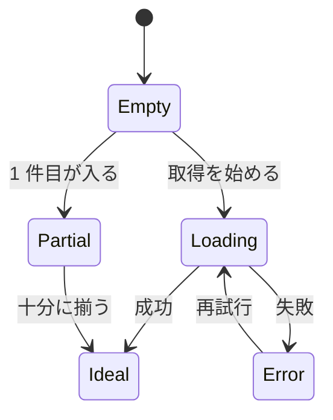

# 画面の状態を漏れなく設計する

データが揃った画面だけを作ると、読み込み中や失敗のときに不自然な画面が残る。
どの画面にも複数の状態があるとみなし、状態ごとに見せたい UI を決めておく。
内容は Scott Hurff の UI Stack と、React 公式ドキュメントの Managing State にもとづく。

## 画面には最大 5 つの状態がある

サーバーの応答には時間がかかり、顧客は想定どおりに使うとは限らない。
そのため、1 つの状態だけの画面はほぼない、と UI Stack は述べている。
1 つの画面は、最大で次の 5 つの状態を持つ。

| 状態    | どんなときか                       | 設計で守ること                             |
| :------ | :--------------------------------- | :----------------------------------------- |
| Ideal   | 中身があふれ、価値を最も出している | 最初に作り、ほかの状態の土台と調子を決める |
| Empty   | 見せるデータがない                 | 行動を促し、関心を保つ                     |
| Error   | 物事がうまくいかなかった           | 入力を守り、次にすべきことを伝える         |
| Partial | 空ではないが、まだ少ししかない     | 落胆してやめるのを防ぎ、Ideal へ導く       |
| Loading | 読み込み、接続待ち、画面遷移の途中 | 期待を設定し、体感の速さを守る             |

状態を後付けにすると、生気のない Awkward UI になる。
読み込み表示がない、何が失敗したかを伝えない、データが少ないと見え方がおかしい、といった形で現れる。



図は、状態の間を行き来する道筋の一例である。
記事はメッセージアプリを例に、状態そのものだけでなく、状態の間の遷移も設計するよう求めている。
遷移がないと、状態が突然現れたり消えたりして、顧客を混乱させる。

## 状態ごとの設計

### Ideal: 最初に作り、ほかの土台にする

Ideal はマーケティングページやアプリストアのスクリーンショットのようなものである。
中核の UI は反復で大きく変わり得るので、その影響はほかの状態に及ぶ。
まず Ideal を作り、そのあとでほかの状態を整える。

### Empty: 3 種類を区別する

Empty は後付けにすると、冷たく味気ない体験になりやすい。
UI Stack は、起きる場面で次の 3 種類に分けている。

1. 初めて使うとき（First-time use / Onboarding）
   - 前向きな文面で、押すべきボタンとその理由を伝える。
     「Nothing to see here」は何も伝えない。
   - コーチマークは、学ぶ負担を顧客に負わせ、操作を中断させるとして挙げられている。
   - プロダクトの中身で操作を教えたり、Ideal のときのスクリーンショットを例として見せたりする案がある。
1. 顧客が自分でデータを消したとき（User-cleared data）
   - 顧客に報いるか、次の行動を促す機会である。
   - 次の一歩を顧客に考えさせず、プロダクトが先回りしてフローに留める。
1. 表示するものがないとき（No results）
   - 顧客の意図を推測して、賢い提案をする機会である。
   - 顧客を行き止まりに追い込まず、使えるものか別の道を示す。

### Error: 入力を守り、次を示す

- エラーのときも、ユーザーの入力をすべて守る。
  理想は、データを消さずに動的にエラーを検出することである。
- 大げさで曖昧な表示にしない。
  文面は簡潔で親しみやすく、次に何をすべきかを示す。
- 「何かがうまくいかなかったとき、自分なら何を伝えてほしいか」を考える。

### Partial: Ideal への道を見せる

空ではなくなっても、データが少ないと顧客は落胆してやめるおそれがある。
ゲームデザインの「acceleration（加速）」の考え方で、将来もっと強くなる自分を思い描かせ、決まった一連の作業へ導く。
例として、LinkedIn の Profile Completeness バーと、Dropbox の追加ストレージまでの残り手順が挙げられている。

### Loading: 体感の速さを守る

体感も実際の速度と同じくらい重要である。
空白とスピナーで画面を埋めると、顧客が時計を見ることになる。
Polar では投票ごとにスピナーを入れたところ、顧客は以前より遅いと感じた。

- スケルトン画面（Skeleton Screens）
  - ページの基本構造を先に表示し、ダウンロードされるにつれて欠けた部分を埋める。
  - 読み込み中であることではなく、読み込まれる中身に注意を向けさせる。
  - 実装の例として、Pinterest は画像の平均色で背景を塗り、Facebook は似た形を脈動させる。
- 楽観的な操作（Optimistic actions）
  - 操作が成功すると仮定して先に完了として扱い、サーバーへの要求は裏で行う。
  - 例は「いいね」とコメントである。
  - 最適な実装ではなく、戻るとデータが捨てられるかもしれないと記事は断っている。

Next.js での読み込み表示の出し方は [React と Next.js のデータ取得の置き場所](/knowledge/frontend/architecture/react-data-fetching.md) を参照する。

## React では見た目の状態ごとに UI を宣言する

React では、UI をコードから直接変更しない。
「ボタンを無効にする」「成功メッセージを表示する」といった命令は書かない。
代わりに、コンポーネントの見た目の状態（「初期状態」「入力中」「成功」など）ごとに、見せたい UI を記述する。
そのうえで、ユーザーの入力に応じて state を変える。
これは、デザイナーが UI を考えるやり方に近い、と Managing State は述べている。

前の節の 5 状態は、この見た目の状態の候補として使える。
`status` のような 1 つの state の値で、どの見た目を返すかを決める。

```tsx
type Status = 'loading' | 'error' | 'empty' | 'ideal';

function List({ status, items }: { status: Status; items: string[] }) {
  if (status === 'loading') return <p>読み込み中</p>;
  if (status === 'error') return <p>読み込めませんでした</p>;
  if (status === 'empty') return <p>まだ何もありません</p>;
  return (
    <ul>
      {items.map((item) => (
        <li key={item}>{item}</li>
      ))}
    </ul>
  );
}
```

Managing State の概要ページの例でも、`status` という state が、送信ボタンを無効にするか、成功メッセージに差し替えるかを決めている。
見た目の状態の洗い出し方や、state の数の絞り方などの手順は、概要ページでは詳しく扱われていない。
詳しくは原典の Reacting to Input with State を参照する。

state の数を増やすときは、重複や矛盾を持ち込まない形にする。
考え方は [React の state の持ち方](/knowledge/frontend/react/react-state-structure.md) を参照する。

## 設計の確認

- 画面ごとに、5 状態それぞれで何を見せるかを決めたか。
- Ideal だけでなく、Loading をプロトタイピングの対象に含めたか。
- エラーを起こすエッジケースを考え、最も痛いものはカバーし、顧客のデータを守れているか。
  費用と効果のトレードオフはある、と記事は述べている。
- 状態の間の遷移が、突然ではなく連続して見えるか。

## See also

- [Scott Hurff: The UI Stack 要約](/references/frontend/ui-design/scotthurff-ui-stack.md)
- [React: Managing State 要約](/references/frontend/react/react-managing-state.md)
- [React と Next.js のデータ取得の置き場所](/knowledge/frontend/architecture/react-data-fetching.md)
- [React の state の持ち方](/knowledge/frontend/react/react-state-structure.md)
