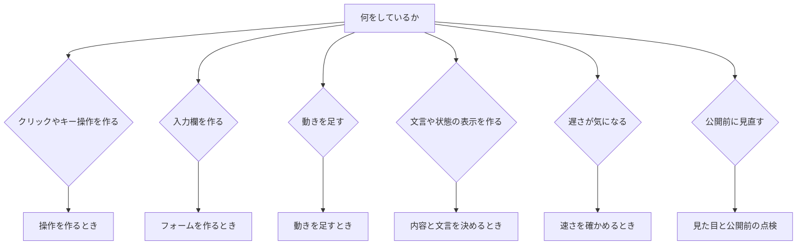

# Web の画面を整えるチェックリスト

画面の出来は、細かな項目を作業の場面で見落とさないことで決まる。
このチェックリストは、作業の場面（操作を作る、フォームを作る、動きを足す、公開前に見直す）ごとに確かめる項目を並べたものである。
内容は Vercel の Web Interface Guidelines の要約にもとづく。
アクセシビリティの考え方そのものは [Web アクセシビリティの基本](/knowledge/frontend/accessibility/web-accessibility.md) を参照する。

## 場面の選び方

## 操作を作るとき

- すべての流れをキーボードで操作できるようにする。
  - 焦点を持てる要素には、見える焦点リングを出す。
  - `:focus` より `:focus-visible` を使い、グループの部品には `:focus-within` を使う。
  - 固定のヘッダーや重なる要素が、焦点のある要素を隠さないか確かめる。
- 見た目が 24px 未満の部品は、当たり判定を 24px 以上に広げる。
  モバイルでは最小 44px とする。
- 遷移には `<a>` や `<Link>` を使う。
  `<button>` や `
` で代用すると、Cmd/Ctrl+クリックや中クリックなどの標準動作が失われる。
- ブラウザの拡大を無効にしない。
  `<input>` と `<textarea>` で貼り付けを禁止しない。
- 状態を URL に持たせ、共有、再読み込み、戻る・進むが効くようにする。
  フィルター、タブ、ページ送り、開閉する領域など、`useState` を使う状態が対象である。
- 成功しそうな操作は UI をすぐ更新し、サーバーの応答で整合させる。
  失敗したら、エラーを示して元に戻すか、Undo を出す。
- 破壊的な操作には、確認か、猶予のある Undo を用意する。
- ドラッグ、スワイプ、ピンチを使う操作には、必須でない限り、タップ・クリックとキーボードの代替手段も用意する。
- 非同期の更新（トーストや入力検証）は、控えめな aria-live で通知する。
- スピナーやスケルトンには、短い表示の遅延（約 150〜300 ms）と最短の表示時間（約 300〜500 ms）を設け、ちらつきを防ぐ。

## フォームを作るとき

- すべての部品に `<label>` を付けるか、ラベルと関連付ける。
  チェックボックスとラジオは、ラベルと部品が 1 つの広い当たり判定を共有する。
- 正しい `type` と `inputmode` を使い、`autocomplete` と意味のある `name` を設定する。
  メール、コード、ユーザー名などでは、スペルチェックを無効にする。
- モバイルの `<input>` の文字サイズは 16px 以上にする（iOS Safari の自動拡大を防ぐため）。
- 入力が不完全でも送信を許し、検証の結果を示す。
  送信ボタンを先に無効にしない。
- エラーは該当する欄の横に出し、送信時は最初のエラーに焦点を移す。
- 送信ボタンは送信が始まるまで有効にし、処理中は無効にしてスピナーを出し、冪等性キーを付ける。
- Enter の扱いは欄で変える。
  - 入力欄が 1 つだけなら Enter で送信する。
  - `<textarea>` では ⌘/⌃+Enter で送信し、Enter は改行にする。
- プレースホルダーは、値を例や形式にし、末尾を省略記号にする（例: `+1 (123) 456-7890`）。
- データが失われそうな遷移の前に、警告する。
- パスワード管理ツールと 2 要素認証に対応し、ワンタイムコードの貼り付けを許す。
  検索など認証でない欄では、パスワード管理ツールを誘発しないようにする。
- ネイティブの `<select>` には、`background-color` と `color` を明示する（Windows のダークモードのコントラスト不具合を避ける）。

## 動きを足すとき

- `prefers-reduced-motion` を尊重し、動きを減らす版を用意する。
- 原因と結果を明確にするとき、または意図した楽しさを加えるときだけ動かす。
- 実装は CSS を優先する。
  優先順位は、CSS、Web Animations API、JavaScript ライブラリの順である。
- 動かす性質は `transform` と `opacity` にする。
  `width`、`height`、`top`、`left` は再配置や再描画を起こすので避ける。
- `transition: all` は使わず、動かす性質だけを明示する。
- 動きは、利用者の入力で中断できるようにする。
- 自動再生は、音のない重要でない繰り返しだけにする。
  ほかの内容と並んで 5 秒を超えて自動で動くものには、一時停止、停止、非表示の操作を付ける。
- SVG の変形は `<g>` で包み、`transform-box: fill-box; transform-origin: center;` を設定する（Safari の起点の不具合を避ける）。

## 内容と文言を決めるとき

- 空、まばら、密、エラーの各状態を設計する。
  どの画面にも、次の一手か回復の道を用意する。
- 利用者が作る内容が、短い、普通、非常に長いのいずれでも、レイアウトが耐えるか確かめる。
- スケルトンは、最終的な内容と正確に同じ形にして、レイアウトのずれを防ぐ。
- 色だけに頼らず、状態を文字のラベルでも示す。
- 数値の比較には `font-variant-numeric: tabular-nums` か等幅フォントを使う。
- 三点リーダーは `...` ではなく `…` を使う。
  続きの入力を求めるメニュー項目（「Rename…」）と処理中の表示（「Saving…」）は、末尾を省略記号にする。
- 日付、時刻、数値、通貨は、利用者のロケールに合わせて整形する。
  言語は `Accept-Language` と `navigator.languages` で判断し、IP や GPS には頼らない。
- アイコンだけのボタンには、説明的な `aria-label` を付ける。
  `aria-*` より先に、ネイティブの要素（`button`、`a`、`label`、`table`）を使う。
- エラーメッセージは、何が悪いかだけでなく、直し方を示す。
  ラベルは「Continue」ではなく「Save API Key」のように具体的にする。
  この文章表現の節は Vercel のブランドの選択であり、普遍の指針ではないと原典が断っている。

## 速さを確かめるとき

- 再描画の回数を最小にする（React DevTools か React Scan で測る）。
- 大きなリストは仮想化する（virtua か `content-visibility: auto`）。
- ファーストビューの画像だけを先読みし、ほかは遅延読み込みにする。
- 画像には明示的な寸法を指定し、場所を確保して、累積レイアウトシフトを防ぐ。
- 重い処理はメインスレッドで行わず、Web Worker に移す。
- 繰り返しの動きには、アニメーション GIF より `<video autoplay muted loop playsinline>` を使う。
  静止画の代替を用意し、`prefers-reduced-motion` を尊重する。

## 見た目と公開前の点検

- 影は、環境光と直接光を模して、2 層以上重ねる。
- 入れ子の角丸は、子の半径を親以下にし、曲線が同心になるようにする。
- `:hover`、`:active`、`:focus` は、通常の状態よりコントラストを上げる。
- コントラストの判断は、WCAG 2 より、知覚に近い APCA を優先する。
- ダークテーマでは、`<html>` に `color-scheme: dark` を設定する。
  `<meta name="theme-color">` で、ブラウザの色を背景に合わせる。
- `<title>` が、いまの文脈を正しく表すか確かめる。
- 見出し `<h1>` から `<h6>` を階層的に使い、「Skip to content」のリンクを置く。
- ノッチなどは、セーフエリアの変数で考慮する。
- 点検は人の目だけに頼らない。
  UI コードの点検には、`web-design-guidelines` スキルを使える。

## See also

- [Vercel: Web Interface Guidelines 要約](/references/frontend/ui-design/vercel-web-interface-guidelines.md)
- [Web アクセシビリティの基本](/knowledge/frontend/accessibility/web-accessibility.md)
