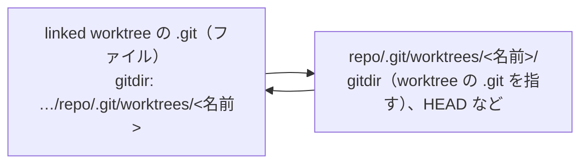

# git worktree の仕組みと扱い方

git worktree（作業ツリーを増やす機能）を使うと、1 つのリポジトリから別のディレクトリに作業ツリーを作り、複数のブランチを同時に開ける。
ブランチを切り替えずに並行して作業できる反面、作業ツリーとリポジトリをパスで結んでいるので、ディレクトリを動かしたり別の環境から開いたりすると結びつきが切れることがある。

## 仕組み

worktree には、元のリポジトリの本体（main worktree）と、後から足した worktree（linked worktree）がある。
両者は、お互いを指すファイルで結ばれている。



- linked worktree の `.git` はディレクトリではなくファイルで、`gitdir:` の行で管理用のディレクトリを指す。
- 管理用のディレクトリは `$GIT_DIR/worktrees/<名前>` に作られる。
  名前は worktree のパスの末尾から付けられ、重なると数字が付く。
- オブジェクトやブランチはリポジトリ本体と共有する。
  worktree ごとに持つのは、作業ツリーと `HEAD`、インデックスなどである。

## 同じブランチは 1 つの worktree でしか使えない

`git worktree add` は、ほかの worktree がチェックアウトしているブランチを指定すると、worktree を作らない。
2 か所で同じブランチを更新すると、片方の作業ツリーが知らないうちに古くなるためである。
`--force` でこの検査を飛ばせるが、使う理由がなければ別名のブランチを作るか、使っている側を別のブランチに切り替える。

## 相対パスで記録する

既定では、2 つのファイルは絶対パスでお互いを指す。
`worktree.useRelativePaths` を `true` にするか、`git worktree add` / `repair` に `--relative-paths` を付けると、相対パスで記録する。

- Git 2.48 で入った。
- 相対パスで記録すると、`extensions.relativeWorktrees` が自動で有効になる。
  これより古い Git は、そのリポジトリを扱えなくなる。
  古い Git が相対パスを誤って解釈しないようにするための拡張である。
- 設定を変えても、すでにある worktree の記録は変わらない。
  書き換えるときは `git worktree repair --relative-paths` を実行する。

## コンテナとホストで worktree を共有する

コンテナにリポジトリを bind mount（ホストのディレクトリをそのままコンテナに見せるマウント）すると、同じディレクトリがホストとコンテナで別の絶対パスになる。
絶対パスで記録した worktree は、作った側でしか開けない。

両方から開けるようにするには、次の 2 つを組み合わせる。

1. リポジトリではなく、その親ディレクトリをマウントする。
   worktree をリポジトリの兄弟ディレクトリに置けば、worktree もマウントの中に入る。
1. worktree を相対パスで記録する。
   リポジトリと worktree の位置関係（`../repo/.git/worktrees/<名前>`）は、どちらの側から見ても同じなので、記録したパスがどちらでも解決できる。

```text
ホスト:     /home/me/src/repo        /home/me/src/feature-1
コンテナ:   /workspace/repo          /workspace/feature-1
記録（共通）: feature-1/.git → gitdir: ../repo/.git/worktrees/feature-1
```

ホストとコンテナの両方の Git が 2.48 以上である必要がある。
古い側は、`extensions.relativeWorktrees` のためにリポジトリそのものを開けなくなる。

worktree をリポジトリの中に置くと、マウントの中には入るが、リポジトリの作業ツリーに入れ子になる。
`.gitignore` で外さないと、`git status` に出て、誤ってコミットされるおそれがある。

## 片付けと修理のコマンド

| コマンド              | すること                                                                                                           |
| :-------------------- | :----------------------------------------------------------------------------------------------------------------- |
| `git worktree list`   | worktree の一覧と、チェックアウトしているブランチを出す                                                            |
| `git worktree remove` | worktree を消す。未コミットの変更や追跡していないファイルがあると止まり、`--force` で消す。本体は消せない          |
| `git worktree prune`  | ディレクトリが消えた worktree の管理情報を消す。`-n` で消す対象だけを出す                                          |
| `git worktree repair` | ディレクトリを手で動かして切れた結びつきを直す。本体で実行し、動かした worktree のパスを渡すと、両方向の記録を直す |
| `git worktree lock`   | いつもはマウントされていない場所にある worktree の管理情報を、自動で消されないようにする。消す・動かす操作も止める |

- worktree のディレクトリを `rm` で消しても、管理情報は残る。
  `git gc` が `git worktree prune --expire 3.months.ago` を呼ぶので、既定では 3 か月後に消える（`gc.worktreePruneExpire` で変えられる）。
  すぐ消すなら `git worktree prune` を実行する。
- 消すときは `rm` ではなく `git worktree remove` を使う。
  未コミットの変更があれば止まるので、作業を失わない。

## See also

- [git-worktree（Git 公式ドキュメント）](https://git-scm.com/docs/git-worktree)
- [git-config の worktree.useRelativePaths（Git 公式ドキュメント）](https://git-scm.com/docs/git-config)
- [Git 2.48.0 のリリースノート](https://github.com/git/git/blob/master/Documentation/RelNotes/2.48.0.adoc)
