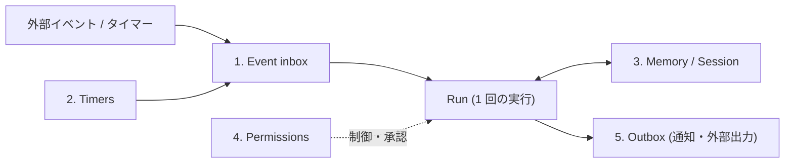

# 常時稼働エージェントの作り方: 5 つの基本部品

Anthropic が公開した記事「常時稼働エージェントの構築 (Building always-on agents)」(著者: William Hu、2026-11-13 公開) の要約である。
人間が毎回チャット画面から指示を出す対話型エージェントとは異なり、バックグラウンドで複数セッションにまたがって無人で稼働し続ける「常時稼働 (Always-on) エージェント」を信頼性高く構築するための実行モデルと 5 つの基本インフラ部品 (プリミティブ) を整理する。

## 概要と Run / Session のサイクル

常時稼働エージェントは、人間の直接の指示を待たずに 24 時間体制でイベントやスケジュールに応答して働き続けるシステムである。
しかし、エージェントのプロセスが常に CPU や LLM を回し続けているわけではない。
実際の常時稼働エージェントは大半の時間を「スリープ」して過ごし、外部からのイベントやタイマーによって起こされ、1 回分のまとまった作業 (`run`) を実行し、作業履歴と文脈 (`session`) や長期メモリを更新して再びスリープに入るというサイクルを繰り返す。

この `run` の内部で動く LLM の推論・ツール呼び出しループ自体は通常の対話型エージェントと同じであるが、その外側を取り囲む以下の 5 つの基本部品 (プリミティブ) の設計がシステム全体の信頼性を左右する。

## 1. Event inbox (イベントの受信箱)

- GitHub や Slack などからの Webhook や外部イベントを、エージェントの実行プロセスへ直接ぶつけてはならない。
- 直接ぶつける設計にすると、エージェントが別のタスクを実行している最中にイベントが到着した際の競合 (レースコンディション) や、プロセスのクラッシュ・再起動時におけるイベント消失が発生する。
- 対策として、耐久性のあるデータベーステーブルやメッセージキューを「イベントの受信箱 (Event inbox)」として前段に挟む。
- 受信エンドポイントはイベントを受け取ったら即座に永続化して `200 OK` を返し、イベント ID による重複排除 (Deduplication) とステータス管理 (`pending` / `processing` / `done`) を行う。
- プロンプトインジェクション検査やコンテキストの組み立てといった重い前処理は、受信時ではなくワーカーがキューからイベントを取り出して実行に移す段階で行う。

## 2. Timers (タイマー)

- 毎朝の定期実行 (cron) だけでなく、エージェント自身が作業の途中で「30 分後にデプロイの状態を再確認する」「明日までに返信がなければリマインドする」といった将来の自己スケジュールを動的に登録できる仕組みである。
- 時刻が到来した際、タイマーが直接エージェントのプロセスを起動するのではなく、上記の Event inbox に「タイマーイベント」を 1 件投入する形をとる。
- これにより、外部からの Webhook イベントと内部のタイマー発火をまったく同じ直列化・耐久性保証・リトライのパイプライン上で統一的に処理できる。

## 3. Memory (メモリ)

- 個々の `run` や `session` をまたいで知識を引き継ぐための長期記憶の仕組みである。
- 過去の全セッションの会話履歴をそのままプロンプトに詰め込み続けると、コンテキストウィンドウが肥大化して推論精度が劣化 (Context rot) し、コストと遅延も増大する。
- そのため、「コードベースを読めばわかること」や「外部 API を叩けば最新状態を再取得できる情報」はメモリに保存しないという原則を徹底する。
- メモリには、ユーザーの好み・チーム固有の運用ルール・過去に行われた重要な意思決定の理由・進行中タスクのブックマークなど、「後から他の情報源を調べても再取得できない事実」だけを構造化して保持する。

## 4. Permissions (権限)

- 人間がリアルタイムで画面を見張っていない常時稼働環境において、プロンプトインジェクションによる暴走や認証情報の漏洩を防ぐガードレールである。
- API キーや OAuth トークンなどの秘密情報は、エージェントのコードが動くサンドボックスの内部には一切配置せず、サンドボックス外の認証プロキシで通信時にのみ付与する。
- ツール呼び出しや外部操作はリスクに応じて段階的に制御し、高リスクな操作は決定論的なルールや分類器 (Classifier) で検査する。
- 本番環境への変更、データの削除、外部顧客へのメール送信など、不可逆で影響範囲の大きい操作については自動的に実行せず、人間の承認 (Human-in-the-loop) を待つ状態に遷移させる。

## 5. Outbox (送信箱)

- エージェントから人間への通知や、外部システムへの最終的な出力を担う出口の仕組みである。
- 無人エージェントが些細な進捗や確信度の低いアラートまで頻繁に通知しすぎると、受け手の人間が通知疲れを起こして無視するようになり (オオカミ少年化)、システムの信頼が失われる。
- そのため、運用開始時は通知を最小限 (Quiet) に絞り、本当に人間の判断や認知が必要な結果だけを Outbox から送り出す。
- オフラインおよびオンラインの評価 (Eval) を通じてエージェントの判断精度を確かめながら、段階的に通知の頻度や自律アクションの範囲を広げていくことが推奨される。

## See also

- [常時稼働エージェントの構築 (Anthropic 公式記事)](https://claude.com/ja/resources/articles/building-always-on-agents)
- [効果的なエージェント自動化の作り方](/references/ai/claude-blog-building-effective-agent-automations.md)
- [長時間動くエージェントのための効果的なハーネス](/references/ai/claude-engineering-effective-harnesses-for-long-running-agents.md)
- [コンテキストエンジニアリング: メモリ・コンパクション・ツール結果のクリア](/references/ai/claude-cookbook-context-engineering-tools.md)
- [Claude Managed Agents の概要](/references/ai/claude-docs-managed-agents-overview.md)
