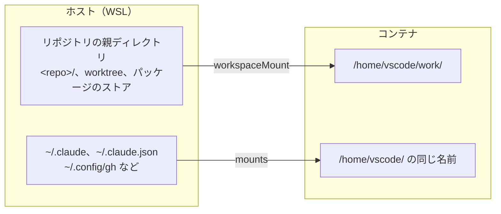

# 親ディレクトリをマウントする Dev Container の構成

Dev Container で git worktree を使うなら、リポジトリそのものではなく、その親ディレクトリをマウントする。
worktree をリポジトリの兄弟ディレクトリに置き、相対パスで記録すると、ホスト（WSL など）とコンテナの両方から同じ worktree を開ける。
ライフサイクルコマンドとマウントの一般的な仕組みは [Dev Container のライフサイクルコマンドとマウント](/knowledge/devcontainer/lifecycle.md) を、相対パスで記録する仕組みは [git worktree の仕組みと扱い方](/knowledge/git/worktree.md) を参照する。

## マウントの構成



| マウント元（ホスト）          | マウント先（コンテナ）                 | 目的                                                   |
| :---------------------------- | :------------------------------------- | :----------------------------------------------------- |
| リポジトリの親ディレクトリ    | `/home/vscode/work`                    | リポジトリと、その兄弟に置く worktree を両側で共有する |
| `~/.claude`、`~/.claude.json` | `/home/vscode/.claude`、`.claude.json` | Claude Code のログインと設定、記憶をホストと共有する   |
| `~/.config/gh`                | `/home/vscode/.config/gh`              | GitHub CLI（`gh`）のログインを共有する                 |

`devcontainer.json` には次のように書く。

```jsonc
{
  "workspaceMount": "source=${localWorkspaceFolder}/..,target=/home/vscode/work,type=bind",
  "workspaceFolder": "/home/vscode/work/${localWorkspaceFolderBasename}",
  "initializeCommand": "bash .devcontainer/initialize.sh",
  "postCreateCommand": "bash .devcontainer/post-create.sh",
  "mounts": [
    {
      "source": "${localEnv:HOME}${localEnv:USERPROFILE}/.claude",
      "target": "/home/vscode/.claude",
      "type": "bind"
    }
    // ~/.claude.json、~/.config/gh も同じ形で足す
  ]
}
```

- 開くパス（`workspaceFolder`）は `/home/vscode/work/<repo>` になる。
- pnpm のストアのようなパッケージの置き場所を親ディレクトリの中に置くと、作り直しても残り、どの worktree のインストールからも使い回せる。
  pnpm なら、ストアはリポジトリと同じファイルシステムの上の `.pnpm-store` に自動で作られる。

## worktree を相対パスで記録する

`post-create.sh` で、リポジトリに `worktree.useRelativePaths = true` を設定する。
worktree はリポジトリから見た相対パスで記録されるので、マウント先のパスがホストとコンテナで違っても、どちらからでも開ける。

```text
ホスト（WSL）: ~/<親>/<repo>             ~/<親>/issue-103
コンテナ:      /home/vscode/work/<repo>  /home/vscode/work/issue-103
記録（共通）:  issue-103/.git → gitdir: ../<repo>/.git/worktrees/issue-103
```

- この設定で、リポジトリの `extensions.relativeWorktrees` が有効になる。
  Git 2.48 より古い Git では、worktree だけでなくリポジトリそのものを開けない。
  ホスト側の Git も 2.48 以上にする。

## 設定スクリプトの分け方


| ファイル               | 動く場所・タイミング    | すること                                                                                 |
| :--------------------- | :---------------------- | :--------------------------------------------------------------------------------------- |
| `initialize.sh`        | ホスト、起動のたび      | `mounts` のマウント元がなければ作る。ファイルのマウント元がなければ空のファイルを作る    |
| `Dockerfile`           | イメージを作るとき      | 足りないパッケージを入れる。`~/.config` と `~/work` を `vscode` の所有で作る             |
| `post-create.sh`       | コンテナ、作るとき 1 回 | 依存のインストール、`worktree.useRelativePaths`、Git フック、`vscode` のパスワードなど   |
| `post-create.local.sh` | コンテナ、作るとき 1 回 | 個人のツールに合わせた設定。コミットせず、ひな形の `post-create.local.sh.example` を置く |

`initialize.sh` の例:

```bash
#!/usr/bin/env bash
set -euo pipefail

# マウント元が無いと、Docker が root 所有のディレクトリを作ってしまう
mkdir -p ~/.claude ~/.config/gh
# ファイルのマウント元が無いと、Docker が同じ名前のディレクトリを作ってしまう
[ -f ~/.claude.json ] || echo "{}" > ~/.claude.json
```

`post-create.sh` の末尾で、ローカルのフックがあれば動かす。

```bash
SCRIPT_DIR="$(cd "$(dirname "${BASH_SOURCE[0]}")" && pwd)"
WORKSPACE_ROOT="$(cd "${SCRIPT_DIR}/.." && pwd)"

git -C "${WORKSPACE_ROOT}" config worktree.useRelativePaths true

LOCAL_HOOK="${SCRIPT_DIR}/post-create.local.sh"
if [ -f "${LOCAL_HOOK}" ]; then
    bash "${LOCAL_HOOK}"
fi
```

- `post-create.sh` に後から足した処理は、今のコンテナには反映されない。
  反映するにはコンテナを作り直す。
  作り直したときに何が消えるかは [Dev Container を作り直したときに残るもの・消えるもの](/knowledge/devcontainer/rebuild.md) にまとめた。
- `post-create.local.sh` は `.gitignore` に足す。

## そのほかの接続

- SSH: コンテナの 2222 番ポートをホストの `127.0.0.1:22222` に転送すると、外部のエディタから入れる。
  詳しくは [Dev Container への SSH 接続](/knowledge/devcontainer/ssh-access.md) を参照する。
- Docker: docker-outside-of-docker の feature を使うと、コンテナからホストの Docker を使える。
  ホストの Docker で動かす DB には、`runArgs` に `--add-host=host.docker.internal:host-gateway` を足し、`host.docker.internal` で接続する。

## 決定理由（Rationale）

- 親ディレクトリをマウントするのは、リポジトリだけをマウントすると、兄弟に置いた worktree がコンテナから見えないためである。
  worktree をリポジトリの中に置く案は、作業ツリーに入れ子になり、誤ってコミットされるおそれがあるので選ばない。
- `initialize.sh` でファイルのマウント元を先に作るのは、ファイルのマウント元がないと、Docker が同じ名前のディレクトリを作ってしまうためである。

## See also

- [Dev Container のライフサイクルコマンドとマウント](/knowledge/devcontainer/lifecycle.md)
- [git worktree の仕組みと扱い方](/knowledge/git/worktree.md)
- [Orca の worktree を Dev Container のマウントの中に置く](/knowledge/devcontainer/orca-worktree.md)
